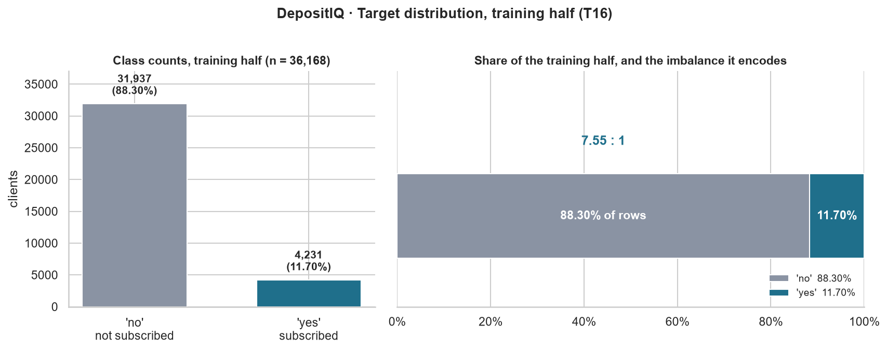
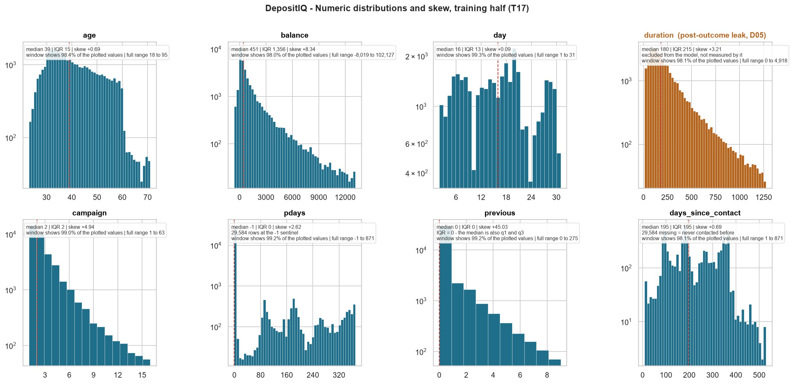
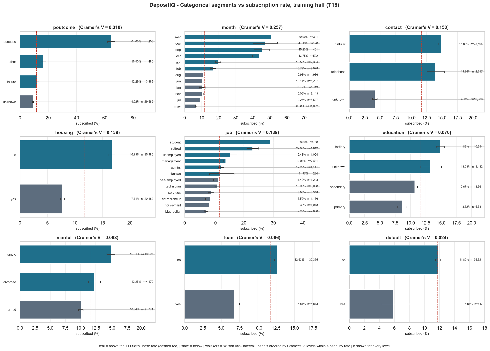
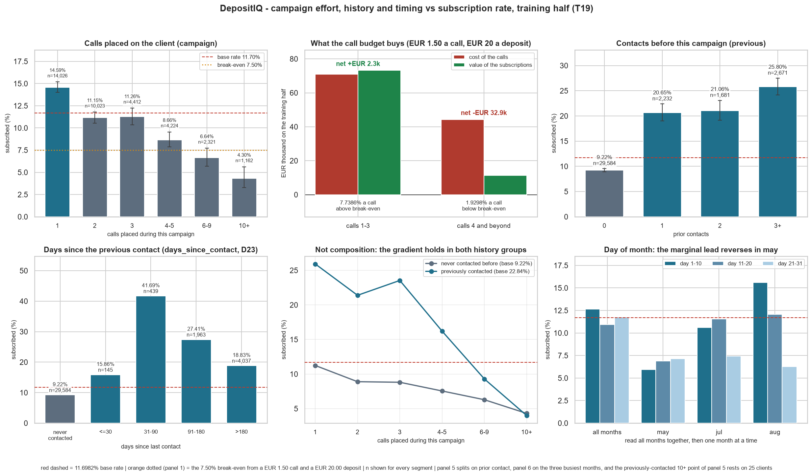
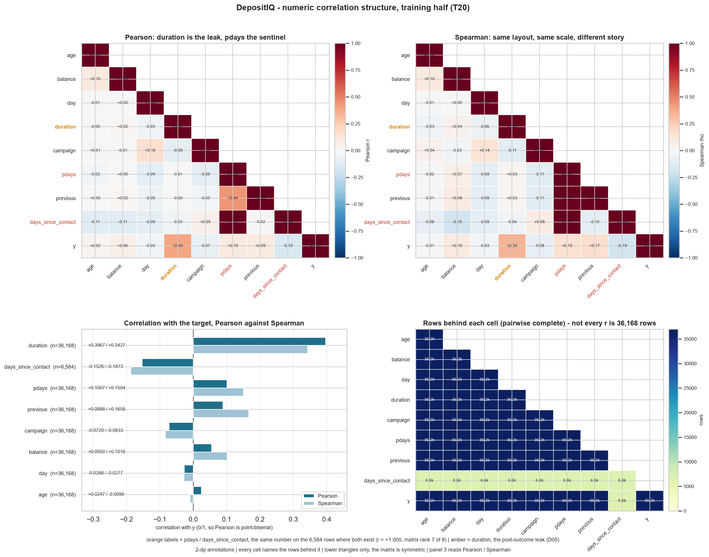

# DepositIQ — EDA Insights

**Rubric:** Criterion 4 — EDA (10 marks)  
**Tasks:** T16–T21 · **Status:** complete, Phase 4 closed · **Date:** 2026-10-28  
**Source of every number:** `notebooks/03_eda.ipynb` §1–§5, run on the **training half** only —
36,168 calls from `data/processed/train.csv`. Nothing here is a new measurement: the five sections'
independent verifiers recomputed **350 checks** (39 + 60 + 123 + 86 + 42), the figures are
byte-reproducible across fresh runs, and the **test half has never been opened**. If a number on
this page disagrees with the notebook, the notebook is right and this page is the bug.

---

## 1. How to read this page

Three conventions, because they decide what each sentence is allowed to mean.

- **Every rate is marginal unless it says otherwise.** "`month = may` converts at 6.68%" means
  clients called in May subscribed at that rate; it does **not** mean moving a client into May would
  change their answer. §3 marks the four findings that were re-tested inside a control, and the
  three that were not.
- **The base rate is the only sane benchmark.** 11.6982% of the training half subscribed, so "high"
  and "low" below always mean relative to **11.6982%**, never relative to 50%.
- **Money uses the project's own cost model**, not a bank figure: a call costs **€1.50** and a
  captured deposit is worth **€20.00** (`docs/01_problem_definition.md` §6.1). Both are **assumed**,
  so the euro totals move with them — but the **7.50% break-even probability (D17)** is the anchor,
  and every euro figure below is that break-even applied to a measured rate.

One term recurs: **"calls beyond the third"** are the calls a cap of three per client would remove —
the extra calls, not the client's first three, which are spent under either policy.

---

## 2. The five figures, and what each one means for the campaign

Figure order here is the order they were built. **The ranked findings in §3 are a different order**,
because a chart's position in a notebook is not a measure of its business value.

| # | Figure | Task | One-line business interpretation |
|---|---|---|---|
| 1 | `01_target_distribution.png` | T16 | One in nine calls ends in a deposit, so an unordered call list wastes 88 of every 100 calls — the campaign needs a ranking, not more calls. |
| 2 | `02_numeric_distributions.png` | T17 | The money and history columns are so skewed that their averages describe nobody, which is a scaling decision rather than a targeting one. |
| 3 | `03_categorical_vs_target.png` | T18 | The previous campaign's outcome converts at **15.7×** the worst segment, so the client file already contains the ranking the campaign is not using. |
| 4 | `04_campaign_vs_target.png` | T19 | Calls stop paying for themselves after the third one, and that is where **€32,906** of the training half's agent time goes. |
| 5 | `05_correlation_heatmap.png` | T20 | No client attribute carries much linear signal, and the one strong-looking column is post-outcome and unusable. |

### 2.1 `01_target_distribution.png` — how lopsided the outcome is (T16)

**Business interpretation:** 11.6982% of clients subscribed, so calling in no particular order
converts one in 8.55 calls and any claim of "88% accurate" is just the majority class talking.

Measured: 4,231 subscribed against 31,937 who did not — a **7.55 : 1** split — reproduced from the
source population's 11.6985% to within 0.0003 pp by the stratified split (D26). An always-"no" model
scores **88.3018%** accuracy while finding nobody, which is why accuracy is disqualified as a
headline metric (D04) and why the PR-AUC baseline is **0.1170**, not 0.5.

### 2.2 `02_numeric_distributions.png` — the shape of the eight numeric columns (T17)

**Business interpretation:** Five of the eight numeric columns are skewed past +2, so they must be
scaled robustly or transformed before any model sees them — and one of them hides a duplicated fact.

Measured: `previous` **+45.03**, `balance` +8.34, `campaign` +4.94, `duration` +3.21, `pdays` +2.62
are the five; only `age` (+0.69), `days_since_contact` (+0.69) and `day` (+0.09) are close to
symmetric. The average balance is **€1,365** against a median of **€451**, and
**3,001 rows (8.30%)** are negative, down to **−€8,019** — so `log1p` is undefined and a median/IQR
scaler divides by zero on the two columns whose IQR is exactly 0.

### 2.3 `03_categorical_vs_target.png` — 44 levels of client attributes (T18)

**Business interpretation:** A prior campaign that ended in success converts at **64.65%** and a
client with no contact record at **4.11%**, a **15.7×** spread the campaign is not currently
exploiting.

Measured: `poutcome = success` — **779 of 1,205 clients**, Wilson 95% interval 61.91%–67.30%,
**5.53×** the base rate — is just **3.33%** of the half yet supplies **18.41%** of all 4,231
subscribers. `contact = unknown` is **427 of 10,386 (4.11%)**, **0.35×** the base rate, and unlike
most extremes it is **28.72%** of the half, so its interval is under one point wide and it still
supplies **10.09%** of subscribers. Cramér's V ranks the nine columns with `poutcome` first
(**0.3102**) and `month` second (**0.2573**).

### 2.4 `04_campaign_vs_target.png` — calls, history and timing (T19)

**Business interpretation:** The fourth call onward costs **€77.73** per extra subscription against
a €20 deposit, so the campaign is paying roughly four times the value of what the extra effort wins.

Measured: clients who needed four or more calls hold **52,658 of the 99,966 calls (52.68%)** for
**570 of the 4,231 subscriptions (13.47%)**. Split at the third call, the calls to clients reached
at most three times convert at **7.7386%** — just above the 7.50% break-even, **+€2,258** net —
while the **29,537** calls beyond turn **€44,306** of agent time into **€11,400** of deposits,
**−€32,906**. The rate falls from **14.59%** on one call to **4.30%** at ten or more.

### 2.5 `05_correlation_heatmap.png` — numeric structure and redundancy (T20)

**Business interpretation:** The strongest linear signal is a column known only after the call ends,
so it must never be used for targeting — and the rest of the numeric columns carry almost nothing
linear.

Measured: `duration` **+0.3967** (Spearman +0.3427), **2.60×** the largest usable number,
`days_since_contact` at **−0.1526** on only **6,584** rows. Of the **28** off-diagonal pairs only
**two** reach |r| ≥ 0.20, and the largest is a duplicate rather than a correlation: `pdays` and
`days_since_contact` are **the same number on all 6,584 rows where both exist**, making the
complete-case matrix **rank 7 of 8** with a VIF of **9.0×10¹⁵** for both.

---

## 3. The findings, ranked by what a campaign planner should act on

**Ranking rule**, applied in this order: (a) how many subscriptions or how many euros are at stake,
(b) whether a planner can act on it before the next campaign, (c) whether it survived a control.
Ranks 1–5 change what happens on a call list; ranks 6–7 are constraints on what may be built, and
are ranked lower because they remove work rather than win subscriptions.

### I1 — Stop paying for the fourth call, and stop it selectively

**The claim.** Calls beyond the third convert at **1.9298%** against a **7.50%** break-even. On the
training half they are **29,537 calls → €44,306 of agent time → €11,400 of deposits**, a net
**−€32,906**, or **€77.73** per extra subscription against a **€20.00** deposit. The calls to
clients reached at most three times convert at **7.7386%**, worth **+€2,258**.

**What the planner does differently.** Caps routine dialling at three attempts per client and moves
the recovered effort to names that have had fewer than three calls.

**Why it is not a blanket rule.** **93.28%** of those extra calls (27,551 of 29,537) go to clients
with **no known prior outcome**, at **1.66%** a call — but clients whose previous campaign
**succeeded** still return **22.55%** a call beyond the third, **€6.65** per extra subscription,
three times break-even. One pooled average would hide exactly the group worth calling.

**How strong it is.** The `campaign` gradient survives inside all four `poutcome` levels — `success`
67.55% → **48.94%**, `other` 19.00% → 10.17%, `failure` 13.41% → 8.28%, `unknown` 11.25% → 6.65% —
inside both history groups, and in all six busiest months (`aug` most sharply, 24.42% → 6.29%). The
euro conclusion is arithmetic about spend, so it needs no causal identification (D33, D34).

### I2 — Call the prior-success clients first, and keep calling them

**The claim.** `poutcome = success` is **3.33%** of the list (**1,205 clients**) and **18.41%** of
the subscribers, at **64.65%** — **5.53×** the base rate.

**What the planner does differently.** This segment goes to the top of the queue and is exempt from
I1's cap, because even its fourth call returns **22.55%**.

**Why it is credible.** Its Wilson interval is 61.91%–67.30% on 1,205 rows, and the gap against
`contact = unknown` sits on the one pair of large segments whose intervals barely overlap.

**What would overturn it.** The claim is a rate on a historical outcome; if the bank's `poutcome`
field is unreliable or missing for newer clients, I3's 28.72% becomes the operative segment instead.

### I3 — Treat "no contact record" as a targeting signal, not a data gap

**The claim.** `contact = unknown` is **28.72%** of the half (**10,386 clients**) and converts at
**4.11%** — **0.35×** the base rate, the lowest of all 44 levels — while still supplying **10.09%**
of the subscribers because it is so large.

**What the planner does differently.** These clients are pushed down the list, or the record is
fixed at source; either way the campaign stops spending its early calls on the weakest bucket in the
data.

**Why it is not a small-sample artefact.** `cellular` and `telephone` are **not** statistically
distinguishable (two-proportion z = 1.16, p = 0.25), so the real split is known channel against
unknown. The unknown group is **28.72%** of the half, which is why its interval is under one point
wide.

### I4 — Move volume out of May

**The claim.** `month = may` holds **11,062 calls (30.59% of the half)** at **6.68%** — barely above
the 7.50% break-even — while `mar` reaches **50.90%** on 391 rows. `may` carries more calls than any
other month at just over half the base rate.

**What the planner does differently.** Test a smaller May allocation and shift attempts into the
months whose rates are highest, measuring the result rather than assuming it transfers.

**What keeps this honest.** The pattern survives a control: restricted to never-contacted clients
(**9.22%** base within that subset) `mar` still returns **50.00%**, so it is timing rather than
prior-success composition. The *ordering among* the small high-rate months is noise — `dec` alone
runs from 39.99% to 54.51% — so act on the group, never on its sequence.

### I5 — Represent prior contact as a flag, not a count

**The claim.** `previous = 0` (**29,584 clients, 81.80%**) converts at **9.22%**; one prior contact
lifts that to **20.65%**, two to **21.06%**, three or more to **25.80%**. The step that matters is
**0 → 1** (**2.24×**); one against two is indistinguishable (20.65% [19.03–22.38] against 21.06%
[19.18–23.07]).

**What the planner does differently.** "Has been contacted before" is a list-ordering flag; the
count beyond one is not worth modelling, which also removes a column with an IQR of exactly 0 (D23).

### I6 — `duration` stays out of the model, and is never quoted as a good predictor

**The claim.** `duration` has the strongest correlation with the target in the file, **+0.3967**
(Spearman +0.3427), **2.60×** the runner-up. It is also only known **after the call ends**, so it
measures the outcome rather than a reason for it.

**What the planner does differently.** Nothing at call time — this is the constraint that makes the
model's numbers believable. It is the reason T22 runs the identical pipeline with and without the
column (D05) instead of reporting **+0.3967** as predictive skill.

### I7 — Do not build rules on day-of-month, or on recency alone

**The claim.** Two patterns that look strong marginally do not survive a control. `day` reads
**12.66%** (days 1–10) against **10.92%** (11–20), then **reverses** inside `may` (**5.94%** against
7.14%) and is entangled with `month` by construction. And `days_since_contact`'s "sweet spot" at
**41.69%** (31–90 days) is prior-success composition: that bucket is **36.2%** prior successes
against **13.0%** for over-180, and inside `poutcome = success` the rate **rises** with age
(**62.89% → 66.48%**).

**What the planner does differently.** Nothing is scheduled by day-of-month, and recency is not sold
as a targeting rule — it enters as a feature and is expected to drop out at T25 once `poutcome` is
present.

---

## 4. What the campaign does on the strength of this

| # | Action | Basis | Size of the effect |
|---|---|---|---|
| A1 | Cap routine dialling at three calls per client | I1 | **−€32,906** avoided, **29,537** calls freed |
| A2 | Put `poutcome = success` at the top and exempt it from the cap | I1, I2 | **18.41%** of subscribers from **3.33%** of the list |
| A3 | Demote `contact = unknown`, or repair the record | I3 | **28.72%** of the list converting at **0.35×** base |
| A4 | Reduce the May allocation and test the shift | I4 | **30.59%** of calls at **6.68%**, against a **7.50%** break-even |
| A5 | Encode prior contact as a flag | I5 | **2.24×** step at zero, **81.80%** of clients affected |
| A6 | Exclude `duration`; quantify what it was hiding | I6 | **+0.3967** vs **−0.1526** for the best usable column |
| A7 | Build no rule on `day` or on recency alone | I7 | 2 rules not built, 2 features demoted to *test, don't assume* |

A1 and A4 are the two that move money; A2 and A3 change the order of the list; A5 and A6 change the
model's inputs; A7 is the negative result that keeps the rest from being built on sand.

---

## 5. What this EDA does not establish

1. **No ranking quality has been measured.** No classifier has been fitted; these are properties of
   the data, not of a model. Whether a model can exploit them is T26–T35's question.
2. **No causal claim.** A segment's rate is a rate. The cap in I1 is argued in money — effort spent
   against deposits won — which is why it does not need a causal claim; the month effect in I4 does,
   and is therefore framed as a test rather than a policy.
3. **`month` carries no year.** Its twelve levels pool every campaign in the file, so the timing
   effect may be partly a property of which year a month belongs to. Untestable from this file, and
   recorded rather than papered over.
4. **The high-rate months are small.** The four best months hold **4.46%** of the half between them
   (178–592 rows) and `dec`'s interval spans 39.99%–54.51%: the group is credible, its order is not.
5. **The euro figures inherit the cost model.** At **€1.50** a call and **€20.00** a deposit the
   totals are I1's; change either input and they move, while the **7.50%** break-even ratio is what
   stays fixed.
6. **The test half is untouched.** Every number here is the training half's 36,168 rows; the
   held-out 9,043 rows remain unread, so nothing in this document has been tuned against them.

---

## 6. Self-check against the done-condition

The task's condition is: *every figure has its one-line business interpretation, and at least five
insights are listed.*

| Requirement | Where satisfied |
|---|---|
| One-line business interpretation for **every** figure | §2.1–§2.5 — five figures, each with a bolded one-sentence interpretation directly under the image, plus the measures behind it |
| ≥ 5 ranked insights | §3 — **seven** (I1–I7), ordered by money at stake, then actionability, then survival under a control |
| Ranked by planner action, not figure order | §3's ranking rule, stated before the list; §2 keeps the figure order and says explicitly that it is not the ranked order |
| Every number already verified | §1 — no new measurement; all values quote the notebook's §1–§5 evidence cells (350 independent checks) |
| Hand-off to the next phase | §4's seven actions and §5's six limits; T22 (leakage audit) and T23–T25 inherit A5, A6 and A7 |

*Interpretation for the viva:* "The EDA's most useful finding is not a client attribute, it is the
call budget: past the third call the campaign buys subscriptions at **€77.73** each against a
**€20** deposit, and **93%** of that loss sits with clients who have no known prior outcome — so the
cap has to be targeted, not blanket. The strongest client signal is the previous campaign's outcome,
**64.65%** against a **11.70%** base rate, and the strongest-looking predictor in the file is
`duration`, which is known only after the call ends and is therefore excluded rather than
celebrated."
