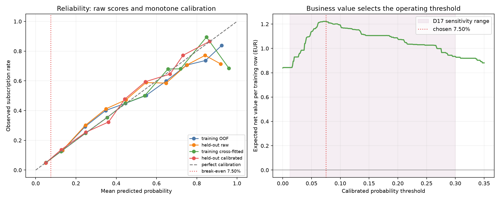

# DepositIQ — Cost-based threshold and calibration

**Rubric:** Criterion 7 — Model Evaluation & Validation (T34)  
**Source:** `python -m src.threshold`, recorded in `models/threshold_eval.json`  
**Date:** 2026-10-30

## Decision

The operating threshold is **7.50%**, not the F1-maximising cut and not 0.5. D17 says a call costs
**€1.50** and a subscription is worth **€20.00**, so the break-even probability is
`p* = C / V = 1.50 / 20.00 = 0.0750`. After calibration, the rule is therefore: call when the
predicted subscription probability is at least 7.50%.

This is a cost decision, not an accuracy decision. On the cross-fitted training predictions, the
chosen cut called **13,882** of **36,168** clients, reached **3,251** subscribers,
and produced **€3.18 expected net value per call**. The €1.50 call cost remains the
cash cost per call; the net-per-call figure includes the observed conversion value and is the quantity
used to compare operating cuts. On the held-out half, which was not used to choose the threshold, the
same rule called **3,407** clients and produced **€3.21 net value per call**.

The older T33 raw-score cut of **0.2103** is retained only as a comparison. It was chosen for F1 on
training folds, so it is not the business rule. The conventional 0.5 cut remains rejected because it
misses most subscribers; accuracy would reward that behaviour in this imbalanced dataset.

| held-out rule | calls | share of list | subscribers reached | net value per call |
|---|---:|---:|---:|---:|
| calibrated D17 break-even, 0.0750 | 3,407 | 37.68% | 802 | €3.21 |
| T33 raw-score comparison, 0.2103 | 1,159 | 12.82% | 561 | €8.18 |

The second row is a useful capacity comparison, not a competing calibration result: it cuts the
unmapped raw score and therefore cannot be interpreted as a 21.03% subscription probability. The bank
can choose the narrower list when capacity is scarce, but the selected rule is the one whose probability
scale and cost threshold have been measured together.

## Calibration check

The XGBoost model is a good ranker but its class weighting inflates raw scores. T34 generated one
out-of-fold raw prediction for every training row, fitted a monotone **isotonic regression** map on
those predictions, and used cross-fitted calibrated predictions to select the threshold. The final
map was then fitted on all training out-of-fold predictions and applied once to the held-out scores.
This keeps the held-out labels out of both calibration and threshold selection.

| scale | mean predicted probability | Brier score |
|---|---:|---:|
| training raw | 0.1167 | 0.0820 |
| training calibrated | 0.1170 | 0.0817 |
| held-out raw | 0.1151 | 0.0804 |
| held-out calibrated | 0.1155 | 0.0803 |

The reliability curves show whether the monotone map transfers to unseen rows. The expected-value
curve shows why the selected cut is 7.50%: below it, calls include clients whose expected subscription
value does not cover €1.50; above it, capacity is traded for more value per call. The sensitivity table
below makes clear how dependent the exact cut is on D17's assumed economics.

## Sensitivity of the break-even rule

The table is generated by `src.cost.sensitivity_table()` and uses only the labelled assumptions in
`src/cost.py`; it is not a measured model result.

| call cost (€) | V=€10 | V=€20 | V=€40 | V=€60 |
|---:|---:|---:|---:|---:|
| €0.75 | 7.50% | 3.75% | 1.87% | 1.25% |
| €1.00 | 10.00% | 5.00% | 2.50% | 1.67% |
| €1.50 | 15.00% | 7.50% | 3.75% | 2.50% |
| €2.00 | 20.00% | 10.00% | 5.00% | 3.33% |
| €3.00 | 30.00% | 15.00% | 7.50% | 5.00% |

The exact 7.50% choice is therefore conditional on D17's €1.50 / €20.00 assumptions. The ranking
model and the calibration measurement are findings from the data; the euro inputs are explicitly not.
