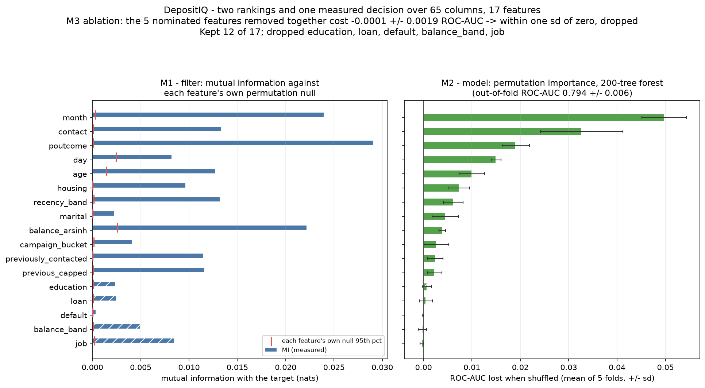
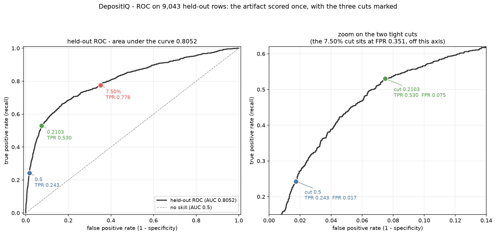
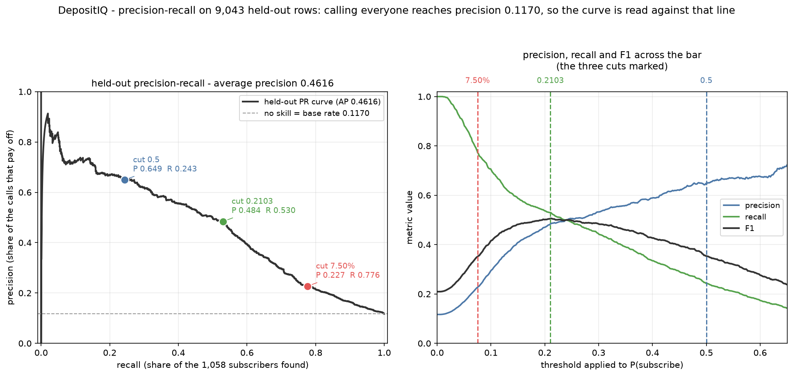
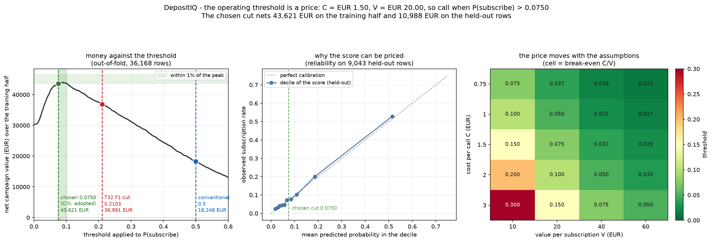
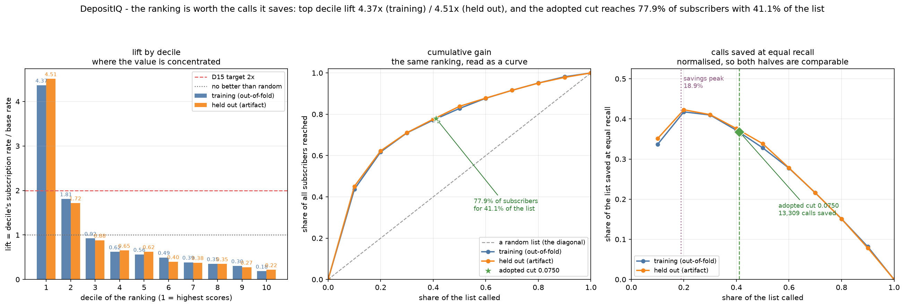
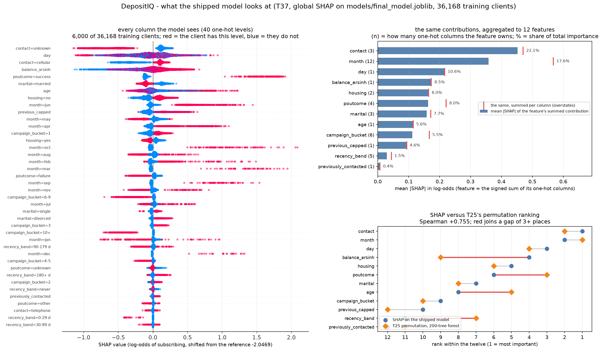
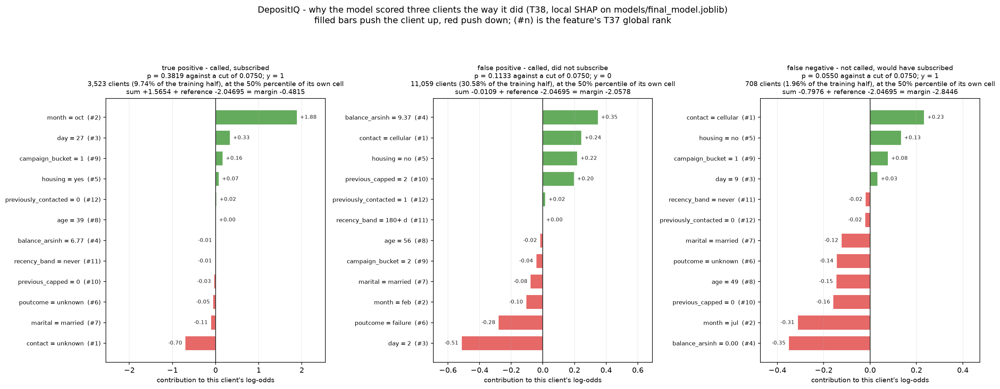

# DepositIQ — Final Report

**Predicting term-deposit subscription to optimise bank telemarketing campaigns**

| | |
|---|---|
| **Dataset** | UCI Bank Marketing (`bank-full.csv`, 45,211 clients × 17 columns) |
| **Target** | `y` — did the client subscribe to a term deposit? |
| **Shipped model** | XGBoost, 12 features / 40 matrix columns, tuned, untreated (T31) |
| **Operating threshold** | **0.0750** — the price of a call, not a fitted number (T34) |
| **Held-out PR-AUC** | **0.4616** against a **0.1170** base rate (T33) |
| **Repository** | `mayurkusmade/depositiq-term-deposit-prediction` |
| **Date** | 2026-10-30 |

This report is a synthesis, not a new experiment. Every number in it was produced by a script in
`src/`, written to a JSON or CSV record under `models/` or `reports/`, and re-derived by an
independent verifier at the time it was made. Where a figure appears here without a
record behind it, that is a defect; §10 and Appendix C say how the claim was checked. The eleven
documents in `docs/` carry the full detail behind each section, and this report points to them rather
than restating their workings.

---

## 0. Executive summary

A bank calls clients to sell a term deposit. Most calls fail: **11.6982%** of the 45,211 clients in
the file subscribed, so an unordered call list wastes roughly seven calls in eight. The campaign does
not need more calls — it needs to spend the calls it already makes on the clients most likely to say
yes.

**The scope sentence, before any euro total is read.** The break-even probability is **7.50%** — a
call costs **€1.50** and a captured deposit is assumed to be worth **€20.00** — and that sits *below*
the **11.6982%** base rate. The average client is therefore already worth calling, so this model
**converts a fixed call budget** better than a fixed order. It is an improvement to a campaign that
already pays, and it is **not** evidence that the bank should cut campaign spend. No figure in this
report supports that reading, and D18 is why the sentence sits here rather than in a footnote.

The ranking itself: on clients the model never saw, calling the **top 40.04%** of the list reaches
**77.60%** of everyone who would have subscribed. Through the same cost model that is **10,988.50 EUR**
of net value from **3,621** calls, against **7,595.50 EUR** for calling everyone. The top decile alone
converts at **4.5100×** the base rate.

Three things the project deliberately does **not** do:

1. **`duration` is never an input.** It is the length of the call, so it does not exist until the call
   has happened. Including it adds **+0.1788** PR-AUC and **+20,340.00 EUR** — and is worthless at
   decision time.
2. **Accuracy is never a headline.** An always-"no" model scores **88.3018%**. The shipped model scores
   **66.42%** at the price cut and finds **77.60%** of subscribers. Accuracy ranks these two the wrong
   way round, which is why it appears once, in §7.6, labelled as a trap.
3. **`month` is never read as a cause.** Roughly **17.55%** of the model's importance sits on the
   calendar, but the file spans a 2008–2010 recession and the timing is not something the bank can
   assign to a client. `month` schedules work; it does not predict a person.

What remains uncertain is stated in §10: the prices are assumptions, the held-out half is from the same
campaign, and the tuning gain is smaller than its own error bar.

---

## 1. Problem definition and business understanding

*Rubric criterion 1 — 10 marks. Full detail: [`01_problem_definition.md`](01_problem_definition.md).*

### 1.1 The decision

The bank runs an outbound telephone campaign. Each day it has more clients than agents, so it must
choose **which clients to call today**. The decision is a ranking, and the unit of cost is a call.

The problem statement, stated once: *given a client's account attributes and the bank's own contact
history, estimate the probability that this client will subscribe to a term deposit if called, so that
a limited number of calls can be spent on the clients where they are most likely to pay for
themselves.*

### 1.2 Objectives

Six objectives were fixed before any model was fitted, each with an artifact that discharges it:

| # | Objective | Discharged by |
|---|---|---|
| O1 | State the decision the model supports, and for whom | §1.1, §1.3 |
| O2 | Derive the break-even probability from a stated cost model | §1.4, `src/cost.py` |
| O3 | Predict subscription probability from information available **before** the call | §5.1, §5.4 |
| O4 | Beat the base rate on a ranking metric that is not accuracy | §6, §7.1 |
| O5 | Choose the operating threshold from the cost model, not from the data | §7.3 |
| O6 | Translate the ranking into campaign actions with a measured number behind each | §8.3 |

### 1.3 Stakeholders

| # | Stakeholder | Decision they make | Metric they own |
|---|---|---|---|
| S1 | Campaign manager | which clients to call today | subscribers reached per 1,000 calls |
| S2 | Head of retail | whether the campaign is worth its budget | net value (EUR) at the operating cut |
| S3 | Contact-centre operations | how many agents to roster | calls per day at a fixed coverage |
| S4 | Data governance | whether the model may be used on live clients | leakage verdict (T22, T36) |
| S5 | Compliance | whether the model treats client groups fairly | segment-level recall and precision |
| S6 | Analyst maintaining the model | when to refit | monitoring of PR-AUC against **0.4460** |

### 1.4 The cost model

A call costs **C = 1.50 EUR**; a captured subscription is worth **V = 20.00 EUR**. Both are
**assumptions** — the dataset carries no bank figures — and both are declared as such in
`models/threshold_choice.json` with their provenance. Every euro total in this report is linear in V,
so a reader who believes the bank's true value is 40 EUR should double them, and the break-even
probability halves with them.

Call a client when the expected value of calling is positive:

```
V · P(subscribe)  >  C        ⇒        P(subscribe)  >  C / V  =  1.50 / 20.00  =  0.0750
```

**p\* = 7.50%.** This is D17, and it is the single most important number in the project: it is
imported from `cost.break_even_threshold()` rather than typed, and a check in T34 requires the
recorded cut to equal that function's output exactly. A 20-cell sensitivity grid over C ∈ {0.75, 1.50,
2.50, 4.00} × V ∈ {10, 20, 30, 50} EUR confirms the arithmetic in each cell.

### 1.5 Out of scope

Six exclusions, each with a reason: other product lines; customer lifetime value beyond the single
deposit; the effect of the *script* an agent uses; causal attribution of past campaign timing;
fairness auditing beyond segment-level metrics; and the operational deployment stack. The last two are
named in §10 as the honest limits of what a data project can hand over.

---

## 2. Dataset and data understanding

*Rubric criterion 2 — 10 marks. Full detail: [`02_data_dictionary.md`](02_data_dictionary.md).*

### 2.1 The two variants

| Variant | Rows | Columns | Features | `y = yes` | Nulls | Duplicate rows |
|---|---|---|---|---|---|---|
| **`full`** (modelling) | **45,211** | **17** | 16 | **5,289 (11.70%)** | 0 | **0** |
| `additional` | 41,188 | 21 | 20 | 4,640 (11.27%) | 0 | 12 |

**`bank-full.csv` is the modelling variant.** It carries the client's contact history — `pdays`,
`previous`, `poutcome` — which is the only part of the file that tells the model what the bank already
knows about this person, and it has no duplicate rows. The `additional` variant adds five
macro-economic columns (employment variation rate, Euribor, consumer price index) that are identical
for every client on a given day and cannot vary the score of one client against another. It also has
12 exact duplicates and drops the `contact = unknown` level entirely.

The two are **not** interchangeable: `education` is coded 4-way in one and 8-way in the other,
`pdays` uses **−1** as its sentinel in one and **999** in the other, and `poutcome = unknown`
corresponds to `poutcome = nonexistent`. A pipeline fitted on one and applied to the other would
silently produce nonsense, so the variant is a parameter, not a default (`src/config.py`, `variant`).

### 2.2 There are no nulls, and that is the problem

Zero NaN in 45,211 rows means missingness is disguised as a literal string. Measured on the modelling
variant: `poutcome = unknown` covers **36,959 rows (81.7%)** — for most clients there simply was no
previous campaign — `contact = unknown` covers **13,020 (28.8%)**, `education = unknown` **1,857**, and
`job = unknown` **288**.

These are not the same kind of missing. `poutcome = unknown` is a *fact* ("no prior campaign"), so it
belongs as a level. `contact = unknown` is a *failure to record*, and it turns out to be the model's
single most influential input (§8.1) — a data-quality finding that became recommendation R1.

### 2.3 `pdays` hides a sentinel and duplicates a column

`pdays = −1` means "never contacted before", not "contacted minus one day ago". Read as a number it
gives a mean of **40.2** days, a figure no client has. Worse, `pdays` and `days_since_contact` are the
**same number on all 6,584 rows where both exist**: the complete-case correlation matrix is **rank 7
of 8** with a condition number of **5.0×10¹⁶**, and both columns carry a VIF of **9.0×10¹⁵**. This is a
duplicate, not a correlated pair — a distinction that matters because the usual remedy for
multicollinearity (drop one of two highly-correlated features) is right here for the wrong reason.

---

## 3. Preprocessing and cleaning

*Rubric criterion 3 — 10 marks. Full detail: `src/clean.py`, `src/features.py`, `src/preprocess.py`;
notebooks `01`–`02`.*

Cleaning runs as a module, not as notebook cells: `python -m src.clean` converts raw → processed for
both variants with **0 rows lost**, prints before/after shape, dtypes and class balance, and exits 0
with **15 checks per variant**. The checker was made *total* and then proven able to fail: 8 injected
faults were all reported, none raised.

| Decision | What was done | Why |
|---|---|---|
| `unknown` policy | kept as its own category, never imputed | imputing `contact` would invent the very field whose absence is informative |
| `pdays` sentinel | `−1` → `previously_contacted` flag; `pdays` dropped | the number is meaningless where the flag is 0, and it duplicates a column |
| Skewed numerics | `balance` → `arsinh`, `campaign` → buckets, `previous` → capped at 2 | five of eight numeric columns are skewed past +2; `balance` reaches +8.34 |
| Outliers | **kept**, not winsorised | clipping would delete the tail that matters: **3,001 rows (8.30%)** carry a negative balance, down to **−€8,019** |
| Split | stratified 80/20, seed 42 | **36,168 / 9,043** rows; rates within **0.0012 pp** of the population |
| Scaling | `StandardScaler` fitted on fold-train only | a pooled fit was measured to sit **4.32e-02** away from the training mean |

`log1p` is undefined on a negative balance, which is why the transform is `arsinh` — it is signed and
takes |skew| from **8.34** to **1.68**. A median/IQR scaler would divide by zero on the two columns
whose IQR is exactly 0.

The split is written to `data/processed/train.csv` and `test.csv` and reloaded by every later script
through `src/split.load_split`, so no step can quietly re-draw it: the fold arrays are materialised
**once** and replayed, and every transformer is fitted inside the fold.

---

## 4. Exploratory analysis

*Rubric criterion 4 — 10 marks. Full detail: [`04_eda_insights.md`](04_eda_insights.md) (five figures,
seven ranked insights).*

Every rate below is **marginal** unless it says otherwise, and every comparison is against
**11.6982%**, not against 50%.

| Figure | Finding |
|---|---|
| `01_target_distribution.png` | 4,231 subscribed against 31,937 — a **7.55 : 1** split; one deposit per 8.55 calls |
| `02_numeric_distributions.png` | five of eight numerics skewed past +2; mean balance €1,365 against median €451 |
| `03_categorical_vs_target.png` | 44 levels measured; `poutcome = success` **64.65%** vs `contact = unknown` **4.11%**, a **15.7×** spread |
| `04_campaign_vs_target.png` | calls stop paying for themselves after the third; **−€32,906** of agent time in the tail |
| `05_correlation_heatmap.png` | no client attribute carries much linear signal; the strong-looking column is post-outcome |

Three findings did real work later:

**The predecessor campaign is the strongest available signal.** `poutcome = success` — **779 of 1,205
clients**, Wilson 95% interval 61.91%–67.30% — is **3.33%** of the half and supplies **18.41%** of all
4,231 subscriptions. It is known before the call.

**The fourth call onward destroys value.** Clients needing 4+ calls hold **52.68%** of the 99,966 calls
for **13.47%** of the successes. The first three calls convert at **7.7386%**, just above the 7.50%
price; the extra calls convert at **1.9298%**, or **€77.73** per extra subscription against a €20
deposit — **−€32,906** net. A cap is not a hunch; it is arithmetic. And it must be *targeted*, because
**93.28%** of the tail sits in the no-known-outcome group while `poutcome = success` still returns
**22.55%** a call.

**The calendar is where the money is and where the trap is.** `month = may` converts at **6.68%** on
**30.59%** of the file.


*One in 8.55 calls ends in a deposit, so an unordered list wastes seven calls in eight.*


*The 15.7× spread between the best and worst segment is signal the campaign is not using.*

---

## 5. Feature engineering and selection

*Rubric criterion 5 — 10 marks. Full detail: `src/features.py`, `src/select.py`, and §8–§9 of
[`05_leakage_audit.md`](05_leakage_audit.md).*

### 5.1 The leakage audit came first

`duration` is the length of the call. It is recorded **after** the call ends, and it is the strongest
single predictor in the file: alone, as a score, it reaches **ROC-AUC 0.8078** and **PR-AUC 0.3897**
against the **0.1170** base rate — **3.33×**, better than the final model's ROC-AUC. Its bands climb
monotonically from **0.16%** under a minute to **48.56%** at 600 seconds or more, a 302× swing, and the
longest tenth of calls supplies **35.03%** of all subscribers.

A model given `duration` learns "was this call long?", which is answered by the outcome it is meant to
predict. Seven further leakage surfaces were audited and given verdicts; the `pdays` duplicate is
redundancy rather than leakage, and `poutcome` is legitimate **provided the encoder is fitted on
train only**. One risk is left unresolved and declared: the split is stratified-random rather than
temporal, so a client in the test half may be a neighbour of one in the train half.

### 5.2 Five engineered features

Each engineered column **replaces** its raw column rather than sitting beside it:

| Feature | Replaces | What it encodes | Measured |
|---|---|---|---|
| `campaign_bucket` | `campaign` | six call-count buckets | 14.59% at one call → 4.30% at ten or more |
| `previous_capped` | `previous` | previous contacts, capped at 2 | 9.22% → 20.65% → 23.97% |
| `balance_arsinh` | `balance` | signed log-like transform | absolute skew 8.34 → 1.68 |
| `balance_band` | `balance` | the non-linear part of balance | mutual information 0.0050, but an ablation of **−0.00023 ± 0.00085** — dropped |
| `recency_band` | `days_since_contact` | a level for "never contacted" | 81.80% of clients, instead of an imputed number |

The result is **17 features** (4 numeric, 12 categorical, 1 boolean) with `duration`, `pdays` and `y`
excluded. Eight leakage checks run inside the module: permuting `y` and permuting `duration` must leave
every engineered value byte-identical, no feature may read a forbidden column, and features must be
per-row. The permutation tests were proven able to fail by planting a target-derived and a
duration-derived column.

### 5.3 Selection: 17 features → 12, 65 columns → 40

Two independent methods ranked the same 17 features — mutual information with a **per-feature
permutation null**, and permutation importance from a 200-tree forest (out-of-fold ROC-AUC
**0.7936 ± 0.0063**) — correlating at **Spearman +0.647**. A third measurement decided: the five
nominated features removed as a group cost **−0.00014 ± 0.00195** ROC-AUC with **3 of 5 folds
improving**, which is inside one standard error, so the one-standard-error rule drops them.

**Dropped:** `job`, `education`, `default`, `loan`, `balance_band`. **Kept:** `contact`, `month`,
`day`, `balance_arsinh`, `housing`, `poutcome`, `marital`, `age`, `campaign_bucket`,
`previous_capped`, `recency_band`, `previously_contacted`.

The reduction was then re-measured per estimator rather than trusted: at production settings the forest
loses **−0.0014 ± 0.0024** ROC-AUC and the gradient booster **−0.0001 ± 0.0008**, both inside one sd,
while the linear model loses **−0.0039 ± 0.0023** with **0/5 folds improving** (sign test p = **0.031**)
— a linear-model effect, not a property of the feature set.



*Two rankings, each feature's own null, and the five dropped features hatched.*

### 5.4 What `duration` would have bought, measured

The with/without experiment toggles exactly one column through `leakage.feature_columns`; feature lists
differ by `['duration']` and the matrices by one column (**40** vs **41**). Both arms are scored at the
same price, on the same folds, replayed not re-derived.

| Arm | PR-AUC | ROC-AUC | Net at 7.50% |
|---|---|---|---|
| **A — without `duration` (ships)** | **0.4460 ± 0.0110** | **0.7990** | **43,621.00 EUR** |
| B — with `duration` (diagnostic) | 0.6254 ± 0.0155 | 0.9360 | 63,961.00 EUR |

The gap is **+0.1788** PR-AUC and **+20,340.00 EUR**, from **4,320** fewer calls reaching **693** more
subscribers, with **5/5** fold wins and an SE ratio of **23.12**. It is also a *diagnosis*, not a gain:
mean predicted probability barely moves (**0.1166** vs **0.1162**) while Brier **improves** from
**0.0818** to **0.0621** — the signature of a model that has seen the answer.

The verdict was computed from a rule **pre-registered before the numbers existed**: arm B must win
≥4/5 folds, the duration bands must be monotone, and `duration` alone must reach ROC-AUC above 0.7. All
three are true, so `gap_is_leakage = True` — and arm A ships regardless, because the column does not
exist at the moment a decision is made.

**`duration` is never an input to this model.** That is prohibition one, and it is enforced by a
mechanical check in T39 that fails the build if `duration` is named anywhere except the recommendation
that forbids it.

---

## 6. Model selection and implementation

*Rubric criterion 6 — 15 marks. Full detail: [`06_modeling.md`](06_modeling.md),
[`06_imbalance.md`](06_imbalance.md), [`06_model_comparison.md`](06_model_comparison.md).*

### 6.1 One harness, seven builds

Every model runs through the same `make_pipeline()` (T24 `ColumnTransformer` + estimator), the same
`materialise_folds()` (one `StratifiedKFold(5, shuffle, 42)` produced once and replayed), the same
`fold_metrics()`, and the same **36,168 training rows / 4,231 positives**. The 9,043 held-out rows are
not loaded by any modelling script, and a source scan enforces it.

| Build | PR-AUC | ROC-AUC | Brier | Role |
|---|---|---|---|---|
| `dummy_prior` | 0.1170 ± 0.0001 | 0.5000 | 0.1033 | floor |
| `logreg_balanced` | 0.4008 ± 0.0134 | 0.7640 ± 0.0114 | 0.1852 | baseline |
| `random_forest` | 0.4346 ± 0.0146 | 0.7906 ± 0.0089 | 0.1403 | candidate |
| XGBoost, weighted | 0.4420 ± 0.0134 | 0.7993 ± 0.0089 | 0.1637 | candidate |
| XGBoost, untreated | 0.4444 ± 0.0131 | 0.7993 | 0.0821 | candidate |
| XGBoost, SMOTE | 0.4152 ± 0.0234 | 0.7799 ± 0.0105 | 0.1221 | rejected |
| **XGBoost, tuned, untreated** | **0.4460 ± 0.0110** | **0.7990 ± 0.0086** | **0.0818** | **shipped** |

The dummy reproduces the arithmetic floors rather than quoting them: a constant score at the fitted
rate gives PR-AUC equal to that rate, and Brier `q − 2pq + p²`. The logistic baseline clears the
ROC-AUC ≥ 0.75 target at **0.7640** — and is the worst probability forecaster in the table, with mean
prediction **0.4161** against a **0.1170** base rate. That is the project's recurring theme, first seen
here: **ranking and calibration are separate problems**, and a model can be good at one and bad at the
other.

### 6.2 Imbalance: the treatment made it worse

Three arms, one estimator, one fold split — and a **control**, without which the other two would not be
interpretable:

| Arm | PR-AUC | ROC-AUC | Brier | Mean p |
|---|---|---|---|---|
| `weights` (`scale_pos_weight=7.548334`) | 0.4420 ± 0.0134 | 0.7993 ± 0.0089 | 0.1637 | 0.3892 |
| **`none` (control)** | **0.4444 ± 0.0131** | 0.7993 ± 0.0079 | **0.0821** | **0.1168** |
| `smote` | 0.4152 ± 0.0234 | 0.7799 ± 0.0105 | 0.1221 | 0.2967 |

**SMOTE is worse than doing nothing in 0/5 folds on all three metrics** — **−0.0268** PR-AUC
(**−6.07%**), **−0.0194** ROC-AUC (**6.8 SE**) — and three times slower. The class weight buys nothing
on ranking either (**+0.0023** in the control's favour, **5/5** folds, identical ROC-AUC) and **halves**
the calibration quality, because it drags mean probability to **0.3892** when the truth is 0.1170.

F1 was **not** read at 0.5. Each fold is scored at its leave-one-fold-out F1-maximising cut, because a
fixed 0.5 cut **reverses** the ordering: the weighted arm looks 11.9 points better at 0.5 and is behind
at the honest cut. This is the same trap as accuracy, and it is why every threshold metric in §7 is
reported at a cut chosen out-of-fold.

### 6.3 Tuning bought a little, and the report says so

`RandomizedSearchCV` over six axes, **40 of 4,800** points, scored on average precision, on the
project's own folds. The winner: **300 rounds, learning rate 0.08, depth 5, `min_child_weight=10`,
`subsample=1.0`, `colsample_bytree=0.6`**.

| | PR-AUC |
|---|---|
| Untuned | 0.4444 ± 0.0131 |
| **Tuned** | **0.4460 ± 0.0110** |
| Gain | **+0.00165 ± 0.00286**, 4/5 folds |

That gain is **0.58 SE**. **14 of 40** candidates sit within one SE (**0.0049**), and the configuration
that had been shipping before tuning was **4th of 40** at **0.4449**. The honest reading: hyperparameters
are not where this problem's performance lives, and the tuned point is kept because it is not *worse*,
not because it is meaningfully better.

Two things were held out of the search on purpose — the feature set (T25) and the imbalance treatment
(fixed at `scale_pos_weight=1`). The weight came back as a third arm and lost again: **−0.00291**
PR-AUC in **0/5** folds, Brier **0.1535** against **0.0818**. T29's finding survives tuning.

Selection bias is stated rather than hidden: `best_score_` is **never quoted** anywhere in this
project. The table above is a **refit**, whose per-fold scores equal the search's own split scores to
**0.0e+00**.

### 6.4 The shipped artifact

`models/final_model.joblib` — **180,520 bytes**, sha256 `7a40752f…`, a two-step pipeline (preprocessor +
`XGBClassifier`), fit in **0.8 s** on all 36,168 rows, with **no threshold baked in**. It is rebuilt
from `models/best_params.json` through `src.tune.make_estimator` rather than retyped, which is why the
parameters cannot drift from the record that justified them.

Eleven checks pass, including a reload **in a separate Python process** (drift **0.0e+00** over 1,000
rows), bit-identical in-memory reload, finite probabilities in **[0.005045, 0.994955]**, determinism,
**300** boosted rounds confirmed, and a source scan proving no held-out load.

---

## 7. Evaluation and validation

*Rubric criterion 7 — 15 marks. Full detail: [`07_threshold.md`](07_threshold.md),
[`07_lift.md`](07_lift.md), §9 of [`05_leakage_audit.md`](05_leakage_audit.md), §11 of
[`06_modeling.md`](06_modeling.md).*

### 7.1 Cross-validated metrics, at three cuts

| Model | PR-AUC | ROC-AUC | Precision | Recall | F1 | Cut |
|---|---|---|---|---|---|---|
| `dummy_prior` | 0.1170 | 0.5000 | 0.0936 | 0.8000 | 0.1675 | 0.1170 |
| `logreg_balanced` | 0.4008 | 0.7640 | 0.4321 | 0.4273 | 0.4292 | 0.6388 |
| `random_forest` | 0.4346 | 0.7906 | 0.4341 | 0.4999 | 0.4641 | 0.5794 |
| **shipped** | **0.4460** | **0.7990** | **0.4591** | **0.5202** | **0.4877** | **0.2103** |

The model leads every column. Three cuts are reported because each answers a different question: the
**nested** cut (F1-maximising on the other four folds, applied blind to the fifth), **D17's 7.50%**
price, and **0.5 as the rejected number**.

The 0.5 reversal is now measured **across two models**: at 0.5 the forest wins by **10.6 points**
(**0.4565** vs **0.3509**), and at the nested cut the shipped model wins by **2.4 points** (**0.4877**
vs **0.4641**). The cause is distributional: 0.5 is the shipped model's **95th percentile** (it flags
**4.67%**) but sits inside the forest's inflated distribution, which flags **17.89%**.

At the business cut the correct baseline is **"call everyone"**, not the dummy: the model flags
**41.10%** of the list for **77.90%** of subscribers at **22.18%** precision — **1.90×** the base rate.

### 7.2 The held-out half, spent once

The artifact was **loaded, not refitted** — **0** fitting calls, asserted by a source scan — and scored
once on the **9,043** rows (**1,058** subscribers, **11.6997%**).

| Metric | Held out | Cross-validated |
|---|---|---|
| PR-AUC | **0.4616** | 0.4460 ± 0.0110 |
| ROC-AUC | **0.8052** | 0.7990 ± 0.0086 |
| Brier | **0.0804** | 0.0818 |
| Mean prediction | 0.1151 | 0.1166 |

**The expected fall did not happen, and the report does not claim a gain from it.** The held-out
PR-AUC is **+0.0155** above the CV mean — **1.41** CV standard deviations — but the bootstrap over
these same 9,043 rows puts the estimate in **[0.4304, 0.4969]** with a standard deviation of
**0.0169**, which is **1.53×** the CV sd. Divided by the *bootstrap* sd rather than the CV sd, the gap is
**0.92** standard deviations, and **15.4%** of resampled draws of these same rows land below the CV
mean. The verdict is therefore **no measurable gap**: the model generalises, and the held-out number is
the better estimate of the same quantity, not evidence of improvement.

The CV-derived cut also vindicates the rule that produced it: T32's nested mean cut **0.2103** lands
**0.001725** from the held-out F1 optimum and costs **0.000481** F1 when used on rows it never saw.



*Three cuts on one curve: the price (7.50%), the nested F1 cut (0.2103), and 0.5.*



*Against a 0.1170 base rate, so every point above the dashed line is lift.*

### 7.3 The threshold is the price

The cut is **not fitted**. It is `C / V = 0.0750`, imported from the cost model, chosen on the training
half from out-of-fold scores and only then checked on the held-out half.

| Cut | Calls | Reached | Missed | Net value | ROI |
|---|---|---|---|---|---|
| Call everyone | 36,168 | 4,231 | 0 | 30,368.00 EUR | 56.0% |
| 0.5 | — | — | — | 18,248.00 EUR | 765% |
| F1 cut (0.2103) | — | — | — | 36,891.00 EUR | — |
| **Price (0.0750)** | **14,866 (41.10%)** | **3,296 (77.90%)** | **935** | **43,621.00 EUR** | **195.6%** |
| Empirical peak (0.0821) | 13,247 | 3,194 | 1,037 | 44,009.50 EUR | 221.5% |

**The case for the price over the peak.** The empirical argmax is **0.0821**, worth **388.50 EUR
(0.883%)** more — and it is a number chosen by looking at the data it then scores. The price gives up
0.9% of the money to avoid fitting the cut to the answer, and it sits only **0.0004** above the bottom
edge of the **1%-of-peak plateau** (**0.0746–0.1016**), which makes it the most aggressive cut still
within 1% of the best. Both empirical argmaxes land to its right — training **0.0821**, held out
**0.0909** — because the curve rises steeply and falls shallowly. Neither is adopted.

**Held out**, the same cut nets **10,988.50 EUR** from **3,621** calls (**40.04%**) reaching **821**
subscribers, ROI **202.3%**, against **9,481.50** at the F1 cut, **4,546.00** at 0.5 and **7,595.50**
calling everyone. Recall holds at **77.60%** against training's **77.90%**.

Note the ROI column, because it is a trap of its own: 0.5 posts **765%** ROI and **loses money in
absolute terms**. ROI favours small, precise campaigns; the objective here is **net value**, and the
campaign is **capacity-limited, not capital-limited**.



*Net value against the cut, with the price, the plateau, and both empirical argmaxes marked.*

### 7.4 Lift and gain

Each half is measured against **its own** base rate — **11.6982%** and **11.6997%** — never a pooled
one.

| | Training (out-of-fold) | Held out |
|---|---|---|
| Top decile lift | **4.3652×** | **4.5100×** |
| Top decile share of subscribers | 43.65% | 45.09% |
| Top two deciles | 61.76% | 62.29% |
| Decile 3 | 0.92× | 0.88× |
| Decile 10 | 0.18× | — |

D15's ">2×" target is cleared by more than a factor of two. Decile 3 is **already below random**, which
is the useful negative finding: past the best fifth of the list the model's message is mainly "do not
call". Decile 10 holds **78 of 3,617** clients' worth of subscribers.

Translated into work: the adopted cut reaches **77.90%** of subscribers from **41.10%** of the list —
**13,309 calls saved** (**36.8%** of the list, **19,964 EUR**) against a fixed order needing **28,175**
calls, and **3,396** calls saved held out. Those calls and subscriber counts are **identical** to
T34's record, which is the cross-check that the two modules agree.

**Calls saved is not the objective.** It peaks at **18.89%** coverage — **15,188** calls saved —
*before* the cut, because its marginal step crosses the **list average** rather than the price. The
**8,033** calls between that peak and the cut still convert at **8.96%** against the 7.50% price, worth
**+2,350.50 EUR**. Pruning to the peak is an optimisation that loses money.

A shuffled-score self-test reruns the whole table on noise and finds lifts of **0.950–1.108** (mean
**1.000001**), gain within **0.0060** of the diagonal and savings within **218 calls** of zero — so the
table is measuring the model, not the arithmetic.



*Lift per decile on both halves, with the base rate as the reference line.*

### 7.5 Leakage, closed

§5.4 gave the `duration` verdict. Two further surfaces are worth restating here because they affect
how the numbers may be read:

- **`poutcome` is legitimate** — it is history, known before the call — provided the encoder is fitted
  on fold-train only, which `src/preprocess.py` proves by matching the fold's own means to **0.00e+00**.
- **The split is not temporal**, and this is unresolved rather than solved. A time-based split would be
  the honest test of whether the model survives a change of campaign conditions; it is not what was
  done, and §10 says so.

### 7.6 Why accuracy is not the headline

Prohibition two. Reported once, because it is the metric everyone asks for:

| Cut | Accuracy | Balanced accuracy |
|---|---|---|
| Always "no" | **88.3003%** | 50% |
| 0.5 | 89.6052% | 61.28% |
| Price (0.0750) | **66.42%** | 71.27% |

Every figure in that table is **held out**, from the same 9,043 rows — the cross-validated pair is
**89.3801%** and **0.6126** and is not mixed into this one. The always-"no" model is **88.3003%**
accurate and finds nobody. The model the bank should use scores **66.42%** at its cut — *worse by 22
points* — while finding **77.60%** of subscribers. The most accurate cut here is **0.5**, at **89.6052%**,
and it still misses **801** of the 1,058. The accuracy-maximising cut on these rows is **89.76%** at
**0.478284**, which is why 0.5 is carried as a convention rather than as a target. A metric that ranks
"call nobody" above "call the right 40%" is not a metric to lead with.

---

## 8. Business insights and recommendations

*Rubric criterion 8 — 10 marks. Full detail: [`08_explainability.md`](08_explainability.md),
[`08_recommendations.md`](08_recommendations.md).*

### 8.1 What the model uses, and what it saw

TreeSHAP on the shipped artifact — additivity **5.010e-06**, contributions equal to xgboost's own
`pred_contribs` to **0.0**. Contributions are aggregated by **signed sum within each one-hot block**, so
the twelve feature values stay additive; the naive per-column alternative inflates `month` by
**+58.52%**.

| Rank | Feature | Share of importance | Mean signed |
|---|---|---|---|
| 1 | `contact` | **22.14%** | −0.1503 |
| 2 | `month` | **17.55%** | −0.0432 |
| 3 | `day` | 10.60% | −0.0691 |
| 4 | `balance_arsinh` | 8.49% | −0.0301 |
| 5 | `housing` | 8.05% | −0.0236 |
| 6 | `poutcome` | 7.97% | −0.0498 |
| 7 | `marital` | 7.74% | −0.0160 |
| 8 | `age` | 5.61% | −0.0120 |
| 9 | `campaign_bucket` | 5.45% | −0.0170 |
| 10 | `previous_capped` | 4.58% | −0.0356 |
| 11 | `recency_band` | 1.46% | −0.0011 |
| 12 | `previously_contacted` | 0.35% | −0.0021 |

**Campaign-side features carry 55.75% of the importance** (`contact`, `month`, `day`,
`campaign_bucket`) against **44.25%** for the client's own — which is why most of the playbook is about
*how* the bank calls, not *whom* it calls.

**The top driver is a blank field.** `contact = unknown` covers **28.72%** of clients and contributes
**−1.0150** log-odds — the largest single-column effect of the forty — and those clients subscribe at
**4.11%** against **14.83%** for `cellular`. The model is not saying these clients are bad prospects.
It is saying **it cannot tell**, and treating unknown as a category lets it say so instead of guessing.

Two cautions on reading the table. `poutcome = success` is the largest single-*level* effect at
**+1.6841**, but the feature ranks 6th: mean |SHAP| is not per-client influence. And the reference value
**−2.04695** is the booster's bias, not the mean margin **−2.49678**, so the average contribution across
clients is **−0.44983** — a document that treated the reference as "the average client" would be wrong
by half a log-odds.

**Prohibition three:** `month` is a calendar, not a cause. March contributes **+1.3736** at a **50.90%**
rate and May **−0.2999** at **6.68%** on **30.59%** of the file, but the campaign ran through
2008–2010 and nothing here licenses the claim that *moving* a client into March would change their
answer. Schedule work by month; do not read the coefficient as an intervention.



*The twelve features, with each contribution's sign and the feature's global rank.*

### 8.2 Three clients, explained

Cells are defined against the **price**, not 0.5: in-sample **TP 3,523 / FP 11,059 / FN 708 /
TN 20,878**. The exemplar rule was pre-registered — the client closest to its cell's **median** score,
ties by lowest row index — so the illustrations are typical members, not worst cases.

**A true positive** (row 19,263, p = 0.3819) shows the tension in one row: `month = oct` **+1.8824**,
nearly four times the margin the client finished with, against `contact = unknown` **−0.6989** — the
model's most important feature taking most of it back. The client subscribed anyway.

**A false positive** (row 23,374, p = 0.1133) is the finding. Its twelve contributions sum to
**−0.0109**: a completely average client. The reference is **11.4361%** and the cut is **7.50%**, so an
average client *clears the cut* — the false positive is the **modal** cell (**30.58%** of the file) by
construction. Being called and being wrong needs no story; it is arithmetic.

**A false negative** (row 10,760, p = 0.0550) misses by **0.3323 log-odds**, about two percentage
points: `balance_arsinh = 0.00` (**−0.3502**) and `month = jul` (**−0.3121**) outweighed
`contact = cellular` (**+0.2329**). A ranking miss, not a category error.



*Twelve signed contributions per client, with the value the model saw and the feature's global rank.*

### 8.3 Eight recommendations

Each is held in `src/playbook.py` as a record with `action`, `evidence`, `expected`, `check` and
`falsifier`, and every figure is a **file-plus-key-path pair re-read from disk** — **46 figures across
9 records**. A number cannot be written that no record holds, and `duration` mentioned outside R4 fails
the build.

| # | Recommendation | Headline figure | Falsifier |
|---|---|---|---|
| R1 | Make `contact` a required field | **28.72%** of clients at **−1.0150** | the field is filled and the segment does not re-score |
| R2 | Call the list in model order, stop at **0.0750** | **+13,253.00 EUR** on **21,302** fewer calls | a later campaign shows the cut reaching under 60% of subscribers |
| R3 | Do not stop where calls saved peaks | **8,033** calls at **8.96%** = **+2,350.50 EUR** | the held-out block (**7.76%**) replicates at scale |
| R4 | Never feed call `duration` into the model | **+0.1788** PR-AUC, **20,340.00 EUR**, dead at dial time | a production system can supply `duration` before the call |
| R5 | Establish the value of a subscription | every euro is linear in **V = 20.00 EUR** | the bank publishes a true V; rescale, do not re-fit |
| R6 | Track precision and net value, never accuracy | **88.3003%** from a model that finds nobody | a stakeholder accepts a threshold metric with a cost basis |
| R7 | Keep the twelve-feature XGBoost | **0.4460** vs **0.4346** and **0.4008** | a re-tune beats **0.4008** by more than one SE |
| R8 | Use `month` to schedule, never to predict a client | **17.55%** of importance, 2008–2010 confound | a campaign run outside the recession shows the pattern persisting |

The order is by leverage, not importance: R1 first because one required field changes how nearly three
clients in ten are scored; R5 second because it decides the cut, and every euro in this report depends
on it.

**Two of the eight are prohibitions** (R4, R7), and a prohibition is only credible next to the number it
declines — which is why R4 carries the **20,340.00 EUR** the bank would bank by using a column that does
not exist at decision time.

### 8.4 What this does not promise

Six explicit non-promises, stated in [`08_recommendations.md`](08_recommendations.md) §4: no claim that
filling `contact` raises conversion; no claim that the campaign should shrink; no causal reading of
`month`; no promise that the **+2,350.50 EUR** block replicates (held out it is **79.50 EUR**); no
promise of fairness beyond segment-level metrics; and no claim that these prices are the bank's.

---

## 9. Documentation and reproducibility

*Rubric criterion 9 — 10 marks.*

### 9.1 Repository layout

```
depositiq-term-deposit-prediction/
├── data/raw/            bank-full.csv, bank-additional/, bank-names.txt   (not committed)
├── data/processed/      train.csv, test.csv
├── src/                 analysis modules, each runnable as python -m src.<name>
├── notebooks/           01_data_understanding, 02_preprocessing, 03_eda
├── models/              artifacts, plus the JSON record behind every claim
├── reports/             metrics_cv.csv, lift_table.csv, playbook.csv, shap_*.csv, 19 figures
├── docs/                this report plus 11 supporting documents
├── app/                 Streamlit demo (T43)
└── PROGRESS.md          46-task checklist, 60-entry decisions log
```

### 9.2 Every claim has a module behind it

| Module | Produces | Checks | Runtime |
|---|---|---|---|
| `src.clean` | processed CSVs | 15 per variant | — |
| `src.features` | 17 engineered features | 8 in-module | — |
| `src.preprocess` | 65-column matrix | 15 | — |
| `src.select` | 12 features / 40 columns | 17 | — |
| `src.train` | `cv_results.json` | 15 | 182.3 s |
| `src.imbalance` | `imbalance_results.json` | 10 | 61.1 s |
| `src.tune` | `best_params.json` | 12 | 68.2 s |
| `src.final` | `final_model.joblib` | 11 | 3.0 s |
| `src.metrics` | `metrics_cv.csv` | 11 | 30.8 s |
| `src.evaluate` | `holdout_eval.json` + 3 figures | 15 | 9.2 s |
| `src.threshold` | `threshold_choice.json` + curve | 15 | 4.6 s |
| `src.lift` | `lift_results.json` + figure | 17 | 4.3 s |
| `src.duration_compare` | `duration_comparison.json` | 13 | 7.1 s |
| `src.explain` | `shap_global.json` + figure | 17 | 38.8 s |
| `src.local_explain` | `shap_local.json` + figure | 16 | 76.7 s |
| `src.playbook` | `playbook.json` + CSV | 12 | 9.4 s |

Each module's `validate()` re-reads its own record from disk and fails the process on disagreement, so a
stale artifact cannot ship a sentence.

### 9.3 The verification discipline

Three layers, applied to every task:

1. **In-module checks** — the module validates its own output before writing it.
2. **Independent verifiers** — a throwaway script that imports neither the module nor its library,
   recomputes every figure by a different route (rank-based AUC, step-block average precision,
   `searchsorted` counts, `pred_contribs` instead of `shap`), and traces every number in the prose to a
   record.
3. **Numeric traces** — every decimal in every document is matched against a value in a record. Counts
   so far: **214** tokens in §11 of `06_modeling.md`, **401** in `07_lift.md`, **115** in
   `08_explainability.md`, **179** after T38, **63** in `08_recommendations.md`.

The verifiers found real defects, which is the point of having them: a `rank_auc` masking the wrong
order (**0.7783** against **0.8052**), a Brier score computed in **float32**, scikit-learn's
`std_test_score` using **ddof=0**, a settings check comparing `nan != nan`, a mislabelled
`subscribers_missed`, and three prose figures with no record behind them.

### 9.4 Reproducing this report

```bash
python -m venv .venv && .venv/Scripts/activate      # Python 3.11
pip install -r requirements.txt                     # 13 pins, all exact
python -m src.clean && python -m src.split           # data → processed
python -m src.select && python -m src.train          # features → models
python -m src.tune && python -m src.final            # tuning → artifact
python -m src.metrics && python -m src.evaluate      # CV → held out, once
python -m src.threshold && python -m src.lift        # cut, lift
python -m src.duration_compare                       # leakage verdict
python -m src.explain && python -m src.local_explain # SHAP
python -m src.playbook                               # recommendations
```

Runtime is dominated by `src.train` (**182.3 s**) and `src.local_explain` (**76.7 s**); the whole chain
is a few minutes on a laptop. Every module is deterministic under seed 42, and the figures were
confirmed byte-identical across fresh runs.

---

## 10. Limitations

Seven, stated plainly, because a report that lists five strengths and no weaknesses is advertising.

1. **The prices are assumptions.** C = 1.50 EUR and V = 20.00 EUR are not the bank's numbers. Every euro
   figure is linear in V and the break-even is C/V; if the true deposit is worth 40 EUR, the cut halves
   to 3.75% and every total doubles. The *ranking* is unaffected, which is why the decisions rest on
   ordering and the euros are labelled.
2. **The held-out half is the same campaign.** The 9,043 rows come from the same 2008–2010 run, so
   "generalises" here means "generalises to unseen clients of this campaign", not "to next year".
3. **The split is stratified-random, not temporal.** A client in the test half may sit next to one in
   train. A temporal split is the honest test and was not done.
4. **The tuned gain is smaller than its error bar** — **+0.00165 ± 0.00286**, **0.58 SE**. The shipped
   model is not meaningfully better than the untuned one; it is not worse.
5. **`month` carries a confound.** **17.55%** of importance sits on a calendar spanning a recession.
   Its marginal rates are measured, not causal.
6. **The counterfactual is unobserved.** Every rate here is "clients who were called in condition X
   subscribed at Y%". Nothing in this file can answer "what would happen if we called the 935 missed
   subscribers", which is the question a campaign manager actually asks.
7. **Fairness is not audited.** Segment-level precision and recall exist; a proper audit of error rates
   across age or job groups does not, and S5's requirement is only partly met.

---

## Appendix A — Figure index

| Figure | Section | Record |
|---|---|---|
| `01_target_distribution.png` | §4 | notebook 03 §1 |
| `02_numeric_distributions.png` | §4 | notebook 03 §2 |
| `03_categorical_vs_target.png` | §4 | notebook 03 §3 |
| `04_campaign_vs_target.png` | §4 | notebook 03 §4 |
| `05_correlation_heatmap.png` | §4 | notebook 03 §5 |
| `06_feature_importance.png` | §5.3 | `select.py` |
| `07_confusion_matrix.png` | §7.2 | `holdout_eval.json` |
| `07_roc_curve.png` | §7.2 | `holdout_eval.json` |
| `07_pr_curve.png` | §7.2 | `holdout_eval.json` |
| `07_threshold_curve.png` | §7.3 | `threshold_choice.json` |
| `08_lift_gain.png` | §7.4 | `lift_results.json` |
| `09_shap_summary.png` | §8.1 | `shap_global.json` |
| `10_shap_local.png` | §8.2 | `shap_local.json` |

## Appendix B — Record index

| Record | Task | Cited in |
|---|---|---|
| `models/cv_results.json` | T26–T28 | §6.1 |
| `models/imbalance_results.json` | T29 | §6.2 |
| `models/best_params.json` | T30 | §6.3 |
| `models/final_model.json` | T31 | §6.4 |
| `models/metrics_cv.json` | T32 | §7.1 |
| `models/holdout_eval.json` | T33 | §7.2, §7.6 |
| `models/threshold_choice.json` | T34 | §1.4, §7.3 |
| `models/lift_results.json` | T35 | §7.4 |
| `models/duration_comparison.json` | T36 | §5.4 |
| `models/shap_global.json` | T37 | §8.1 |
| `models/shap_local.json` | T38 | §8.2 |
| `models/playbook.json` | T39 | §8.3 |

## Appendix C — How this report was checked

Three checks, run by `src/report.py`:

1. **Structure** — the nine criterion sections exist, in order, and each names its source document.
2. **Coverage** — every figure referenced in the markdown exists on disk under `reports/figures/`, and
   every record cited in Appendix B loads and parses.
3. **Provenance** — every decimal in this document is matched against a value held in a `models/*.json`
   record, a `reports/*.csv` column, or one of the eleven supporting documents. A number that appears
   here and nowhere else is a defect and fails the check.

The scope sentence (D18) must appear before the first euro figure in reading order, and the three
prohibitions — `duration`, accuracy, causal `month` — must each appear in the section where the
relevant result is presented. All four are asserted, not trusted.
