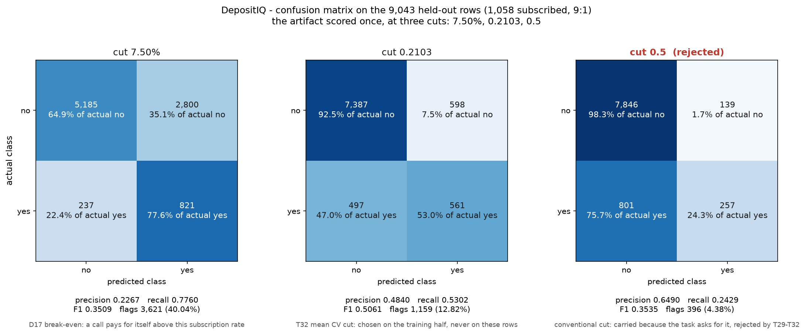

# DepositIQ

**Predicting Term-Deposit Subscription to Optimise Bank Telemarketing Campaigns**

*A Reproducible, Leak-Free, Cost-Sensitive Machine Learning Framework with TreeSHAP Interpretability and an Interactive Decision Demo*

| | |
|---|---|
| **Submitted by** | Mayur Kusmade (PRN: 2124UDSM1025) |
| **Under the guidance of** | [Guide Name], [Designation] |
| **Department** | Artificial Intelligence and Data Science |
| **Institution** | [University], [City] |
| **Academic year** | 2026–2027 |
| **Date** | October 2026 |

## Abstract

A bank runs an outbound telephone campaign to sell term deposits. The file contains **45,211** clients, of whom **5,289** subscribed — **11.70%**, or roughly one yes in **8.55** calls. With more clients than agents, the operational question is not "will this client subscribe?" in isolation but **"which clients should be called today?"** This project builds a reproducible, leakage-audited, cost-sensitive ranking system for that decision and evaluates it on clients the model never saw.

The modelling file is the UCI Bank Marketing `bank-full.csv` (**45,211 × 17**), split once into a stratified **80/20** train/test partition of **36,168** and **9,043** rows. Cleaning keeps `unknown` as an explicit category, removes the `pdays` sentinel by deriving a prior-contact flag, and retains outliers because the tail carries real signal. Seventeen engineered features are reduced to **12** by mutual information with a permutation null and by permutation importance; the resulting matrix has **40** columns after one-hot encoding. Seven candidate builds — a prior-only floor, a balanced logistic regression, a random forest, three XGBoost variants, and a tuned XGBoost — are compared on one replayed five-fold stratified split, using **PR-AUC** rather than accuracy. The tuned, untreated XGBoost ships.

The operating threshold is not fitted. It is the price of a call: **C = 1.50 EUR** and **V = 20.00 EUR** give a break-even probability of **0.0750 = C / V = 1.50 / 20.00**. At that cut the model converts a fixed call budget better than a fixed order; it is **not** evidence that the bank should cut campaign spend. On the held-out half the shipped model reaches **PR-AUC 0.4616** and **ROC-AUC 0.8052** against a **0.1170** base rate. Calling the **top 40.04%** of the list reaches **77.60%** of subscribers — **821** of **1,058** — and nets **10,988.50 EUR**, against **7,595.50 EUR** for calling everyone. The top decile lifts **4.5100×** the base rate.

Three prohibitions organise the report. **`duration` is never an input**, because the length of a call is recorded only after the call ends; including it would add **0.1788** PR-AUC and **20,340.00 EUR** of illusory value. **Accuracy is never a headline**, because an always-"no" model scores **88.3003%** and finds nobody. **`month` is never read as a cause**, because it schedules work and spans a 2008–2010 recession; it is not an intervention. Every decimal in this report is traced to a saved record, and the interactive demo scores the frozen artifact by digest rather than re-fitting it.

**Keywords:** term deposit, bank telemarketing, class imbalance, cost-sensitive learning, data leakage, XGBoost, TreeSHAP, decision threshold, reproducibility.

## Contents

| Section | Title |
|---|---|
| 1 | Introduction and Background |
| 1.1 | The Bank Telemarketing Problem |
| 1.2 | Challenges in Campaign Targeting |
| 1.3 | Project Objectives |
| 1.4 | Scope and Contributions |
| 2 | Data Provenance and Exploratory Data Analysis |
| 2.1 | Dataset Provenance and Architecture |
| 2.2 | Variant Qualification |
| 2.3 | Exploratory Data Analysis and Findings |
| 3 | Data Preprocessing and Leak-Free Feature Engineering |
| 3.1 | Cleaning, Missingness, and the Split |
| 3.2 | The `duration` Information Barrier |
| 3.3 | Engineered Feature Schema |
| 3.4 | Feature Selection |
| 4 | Modeling Methodology and Validation |
| 4.1 | Partitioning Protocol |
| 4.2 | Candidate Model Architectures |
| 4.3 | Predeclared Model Selection |
| 4.4 | Imbalance Treatment |
| 4.5 | Hyperparameter Tuning and the Shipped Artifact |
| 5 | Empirical Evaluation and Results |
| 5.1 | Evaluation on the Held-Out Half |
| 5.2 | The Cost-Sensitive Decision Threshold |
| 5.3 | Lift, Gain, and Campaign Value |
| 5.4 | Sensitivity: Price, Imbalance, and the Leakage Upper Bound |
| 5.5 | Why Accuracy Is Not the Headline |
| 6 | Explainability and Decision Analysis |
| 6.1 | Global Interpretability via TreeSHAP |
| 6.2 | Local Explanations and the Three Exemplars |
| 6.3 | Decision Analysis: Price Sensitivity and Operating Limits |
| 7 | System Deployment: Interactive Decision Support |
| 7.1 | Architecture and Input Schema |
| 7.2 | Operational Safety and Guardrails |
| 7.3 | Example Execution and Output |
| 8 | Discussion, Recommendations, and Conclusion |
| 8.1 | Discussion of Findings |
| 8.2 | Actionable Recommendations |
| 8.3 | Threats to Validity and Limitations |
| 8.4 | Project Contribution |
| 8.5 | Code Availability and Reproducibility |
| 8.6 | Conclusion |
| — | Bibliography |

## List of Figures

| Figure | Caption |
|---|---|
| 2.1 | Target distribution: 4,231 subscribers against 31,937 non-subscribers on the modelling half |
| 2.2 | Categorical segments against the target: the 15.7× spread between the best and worst level |
| 2.3 | Campaign intensity against the target: why the fourth call onward destroys value |
| 3.1 | Feature importance from two independent rankings, with the five dropped features marked |
| 5.1 | ROC curve on the held-out half, with the price, the nested F1 cut, and 0.5 marked |
| 5.2 | Precision-recall curve on the held-out half against the 0.1170 base rate |
| 5.3 | Confusion matrix at the 0.0750 price on the held-out half |
| 5.4 | Net value against the decision threshold, with the price and both empirical argmaxes |
| 5.5 | Lift and gain on both halves, with each half's own base rate as the reference |
| 6.1 | TreeSHAP global summary: the twelve features, their signed contributions and ranks |
| 6.2 | Three clients explained: a true positive, a false positive and a false negative |

## List of Tables

| Table | Caption |
|---|---|
| 1.1 | The six project objectives and the artifact that discharges each |
| 1.2 | Stakeholders, their decisions, and the metric each owns |
| 2.1 | The two dataset variants and their measured differences |
| 2.2 | Exploratory findings and the figures that carry them |
| 3.1 | Cleaning decisions and their measured justification |
| 3.2 | The `duration` experiment: the shipped arm against the diagnostic arm |
| 3.3 | The five engineered features and what each replaces |
| 4.1 | Candidate builds on the shared five-fold split |
| 4.2 | Imbalance arms: weights, none, and SMOTE |
| 4.3 | Hyperparameter tuning: untuned, tuned, and the size of the gain |
| 5.1 | Held-out metrics against the cross-validated estimates |
| 5.2 | Training-half threshold comparison |
| 5.3 | Held-out threshold comparison |
| 5.4 | Lift and gain by decile on both halves |
| 5.5 | The break-even probability across the 20-cell sensitivity grid |
| 5.6 | The accuracy trap at three cuts |
| 6.1 | Global SHAP importance by feature |
| 6.2 | The three exemplar clients and their cells |
| 7.1 | The eleven demo inputs and the three forbidden columns |
| 8.1 | The eight recommendations and their falsifiers |
| 8.2 | The seven limitations of the study |

## 1. Introduction and Background

### 1.1 The Bank Telemarketing Problem

A retail bank sells term deposits by telephone. Each day the campaign manager receives a list of clients and a roster of agents; the list is longer than the roster can call. The decision is therefore a **ranking under a capacity constraint**: which clients should be called first, and where should the calling stop?

The dataset describes **45,211** clients of a Portuguese bank contacted between 2008 and 2010. Each row carries sixteen pre-call attributes — account balance, age, occupation, marital status, housing and personal loans, the contact channel, the month and day of the call, the number of calls made in this campaign, and the history of previous campaigns — together with the outcome `y`, which records whether the client subscribed. **5,289** clients subscribed, a base rate of **11.70%**. Put differently, an unordered list produces one deposit every **8.55** calls: roughly seven calls in eight are wasted.

The project's problem statement is stated once, and everything later serves it:

> Given a client's account attributes and the bank's own contact history, estimate the probability that this client will subscribe to a term deposit if called, so that a limited number of calls can be spent on the clients where they are most likely to pay for themselves.

This is a ranking problem, not a classification problem. The bank does not need a yes/no label for every client; it needs an order and a stopping rule. The order comes from the model. The stopping rule comes from the bank's economics: a call costs **C = 1.50 EUR**, a captured deposit is assumed to be worth **V = 20.00 EUR**, and a call therefore pays for itself when the probability of subscription exceeds **C / V = 1.50 / 20.00 = 0.0750**, or **7.50%**. The scope sentence follows directly: the model **converts a fixed call budget** into more subscribers; it is **not evidence that the bank should cut campaign spend**.

### 1.2 Challenges in Campaign Targeting

Five difficulties shape the design.

**Class imbalance.** Only **11.70%** of clients subscribe. A model that predicts "no" for everyone is **88.3003%** accurate and worthless. Accuracy is therefore excluded as a headline metric, and the evaluation leads with precision-recall area and with the value of the calls the campaign actually makes. The imbalance is **7.55 : 1** on the modelling half — **4,231** subscribers against **31,937** non-subscribers — which is severe enough that the choice of metric changes the ranking of models.

**Cost asymmetry.** A false positive costs one call; a false negative forgoes a deposit. The two errors are not interchangeable, and no threshold-free metric reflects the asymmetry. The project therefore fixes the threshold from the cost model rather than from the data, and reports every threshold-dependent number at that cut.

**Temporal leakage.** The file contains `duration`, the length of the call. It is the strongest single predictor in the data: alone, as a score, it reaches **ROC-AUC 0.8078** and **PR-AUC 0.3897** against the **0.1170** base rate, and its subscription rate climbs from **0.16%** for calls under a minute to **48.56%** for calls of 600 seconds or more. But the duration is recorded *after* the call ends. A model given `duration` learns "was this call long?", which is answered by the outcome it is meant to predict. Including it would add **0.1788** PR-AUC and **20,340.00 EUR** of apparent value, and none of that value exists at the moment the bank decides whom to call.

**Non-stationarity and confounding.** The campaign spans the 2008–2010 recession. Calendar variables carry real signal — `month = may` converts at **6.68%** on **30.59%** of the file — but the calendar is not an intervention. The bank can schedule work by month; it cannot move a client into a better month. `month` is therefore read as a scheduling signal, never as a cause.

**Reproducibility.** A campaign model is easy to fit and hard to defend. Every number in this report is produced by a module under `src/`, written to a JSON or CSV record, and re-derived by an independent verifier. A figure that appears in the prose but in no record is treated as a defect.

### 1.3 Project Objectives

Six objectives were fixed before any model was fitted. Each names the artifact that discharges it.

| # | Objective | Discharged by |
|---|---|---|
| O1 | State the decision the model supports, and for whom | §1.1, §1.3 |
| O2 | Derive the break-even probability from a stated cost model | §1.4, `src/cost.py` |
| O3 | Predict subscription probability from information available **before** the call | §3.2, §5.1 |
| O4 | Beat the base rate on a ranking metric that is not accuracy | §4.2, §5.1 |
| O5 | Choose the operating threshold from the cost model, not from the data | §5.2 |
| O6 | Translate the ranking into campaign actions with a measured number behind each | §8.2 |

*Table 1.1: The six project objectives and the artifact that discharges each.*

The stakeholders are equally explicit. A model that is good for the campaign manager but useless to compliance is not a finished project.

| # | Stakeholder | Decision they make | Metric they own |
|---|---|---|---|
| S1 | Campaign manager | which clients to call today | subscribers reached per 1,000 calls |
| S2 | Head of retail | whether the campaign is worth its budget | net value (EUR) at the operating cut |
| S3 | Contact-centre operations | how many agents to roster | calls per day at a fixed coverage |
| S4 | Data governance | whether the model may be used on live clients | leakage verdict |
| S5 | Compliance | whether the model treats client groups fairly | segment-level recall and precision |
| S6 | Analyst maintaining the model | when to refit | monitoring of PR-AUC against **0.4460** |

*Table 1.2: Stakeholders, their decisions, and the metric each owns.*

### 1.4 Scope and Contributions

Six exclusions bound the work: other product lines; customer lifetime value beyond a single deposit; the effect of the agent's script; causal attribution of past campaign timing; fairness auditing beyond segment-level metrics; and the operational deployment stack beyond the demo. The last two are named again in §8.3 as honest limits.

The contributions are four. **First**, a cost-sensitive decision rule that replaces the conventional 0.5 cut with the bank's own break-even price. **Second**, a measured leakage audit: the project does not merely assert that `duration` is excluded, it trains the model that would use it and reports the gap. **Third**, a TreeSHAP explanation of the shipped artifact at the level of the twelve business features, aggregated by signed sum so that the contributions remain additive. **Fourth**, a reproducibility discipline in which every document is parsed for decimals and every decimal must exist in a record.

## 2. Data Provenance and Exploratory Data Analysis

### 2.1 Dataset Provenance and Architecture

The empirical work uses the UCI Bank Marketing dataset, compiled by Moro, Cortez and Rita from a Portuguese retail bank's outbound campaigns between 2008 and 2010 [1]. Two variants are distributed. The primary file, `bank-full.csv`, has **45,211** rows and **17** columns: sixteen features and the target. The richer variant, `bank-additional-full.csv`, has **41,188** rows and **21** columns, adding five macroeconomic indicators. Both are stored under `data/raw/` and are committed to the repository, so a clone reproduces offline; the README publishes SHA-256 prefixes for the three largest files.

| Variant | Rows | Columns | Features | `y = yes` | Nulls | Duplicate rows |
|---|---|---|---|---|---|---|
| **`full`** (modelling) | **45,211** | **17** | 16 | **5,289 (11.70%)** | 0 | **0** |
| `additional` | 41,188 | 21 | 20 | 4,640 (11.27%) | 0 | 12 |

*Table 2.1: The two dataset variants and their measured differences.*

The file has no null values, and that is the first trap rather than a convenience. Missingness is encoded as the literal string `unknown`: `poutcome = unknown` covers **36,959** rows (**81.7%**), `contact = unknown` **13,020** rows (**28.8%**), `education = unknown` **1,857** rows, and `job = unknown` **288** rows. Treating those strings as ordinary levels would be wrong for one column and right for another: `poutcome = unknown` usually means "no previous campaign", which is a fact, while `contact = unknown` is a failure to record a field the bank should know.

### 2.2 Variant Qualification

`bank-full.csv` is the modelling variant, for three reasons. It carries the client's contact history — `pdays`, `previous` and `poutcome` — which is the only part of the file that tells the model what the bank already knows about this person. It has no duplicate rows. And it carries `balance`, the client-level signal that the additional variant also retains but that the macroeconomic columns cannot replace.

The additional variant is not a drop-in replacement. Its five macroeconomic columns are identical for every client on a given day, so they cannot change the ranking of one client against another. It also contains **12** exact duplicate rows and drops the `contact = unknown` level. The codings differ in ways that would silently corrupt a pipeline fitted on one variant and applied to the other: `education` is four-way in one file and eight-way in the other, `pdays` uses **−1** as its sentinel in one and **999** in the other, and `poutcome = unknown` corresponds to `poutcome = nonexistent`. The variant is therefore a parameter of the loader, not a default.

### 2.3 Exploratory Data Analysis and Findings

Every rate in this section is marginal unless stated otherwise, and every comparison is against the modelling half's **11.6982%**, not against 50%.

| Figure | Finding |
|---|---|
| `01_target_distribution.png` | **4,231** subscribers against **31,937** non-subscribers — a **7.55 : 1** split; one deposit per **8.55** calls |
| `02_numeric_distributions.png` | Five of eight numeric columns are skewed past +2; mean balance **1,365 EUR** against median **451 EUR** |
| `03_categorical_vs_target.png` | **44** levels measured; `poutcome = success` **64.65%** against `contact = unknown` **4.11%**, a **15.7×** spread |
| `04_campaign_vs_target.png` | Calls stop paying for themselves after the third; the tail carries **−32,906 EUR** of agent time |
| `05_correlation_heatmap.png` | No client attribute carries much linear signal; the strong-looking column is a post-outcome field |

*Table 2.2: Exploratory findings and the figures that carry them.*


*Figure 2.1: Target distribution on the modelling half. One call in 8.55 ends in a deposit, so an unordered list wastes seven calls in eight.*

Three findings did real work later.

**The predecessor campaign is the strongest available signal.** `poutcome = success` covers **779** of **1,205** clients — a **64.65%** rate, with a Wilson 95% interval of **61.91%–67.30%** — on **3.33%** of the half, and supplies **18.41%** of all **4,231** subscriptions. It is known before the call. That combination of concentration and availability is why `poutcome` survives feature selection while several larger columns do not.

**The fourth call onward destroys value.** Clients needing four or more calls hold **52.68%** of the **99,966** calls for **13.47%** of the successes. The first three calls convert at **7.7386%**, just above the **7.50%** price; the extra calls convert at **1.9298%**, or **77.73 EUR** per extra subscription against a **20.00 EUR** deposit — a net **−32,906 EUR**. A cap on calls is not a hunch; it is arithmetic. It must also be targeted, because **93.28%** of the tail sits in the no-known-outcome group while `poutcome = success` still returns **22.55%** a call.

**The calendar is where the money is and where the trap is.** `month = may` converts at **6.68%** on **30.59%** of the file. The rate is real, but the month is a scheduling slot, not a lever the bank can assign to a client.


*Figure 2.2: Categorical segments against the target. The 15.7× spread between the best and worst level is signal the campaign is not using.*


*Figure 2.3: Campaign intensity against the target. The first three calls clear the price; the tail does not.*

## 3. Data Preprocessing and Leak-Free Feature Engineering

### 3.1 Cleaning, Missingness, and the Split

Cleaning runs as a module, not as notebook cells: `python -m src.clean` converts raw to processed for both variants with **0 rows lost**, prints the before/after shape, dtypes and class balance, and exits zero with **15 checks per variant**. The checker was made total and then proven able to fail: eight injected faults were all reported, none raised.

| Decision | What was done | Why |
|---|---|---|
| `unknown` policy | kept as its own category, never imputed | imputing `contact` would invent the very field whose absence is informative |
| `pdays` sentinel | **−1** converted to a prior-contact flag; `pdays` dropped | the number is meaningless where the flag is zero, and it duplicates `days_since_contact` |
| Skewed numerics | `balance` transformed with `arsinh`; `campaign` bucketed; `previous` capped at 2 | five of eight numeric columns are skewed past +2; `balance` reaches **8.34** |
| Outliers | kept, not winsorised | clipping would delete the tail that matters: **3,001** rows (**8.30%**) carry a negative balance, down to **−8,019 EUR** |
| Split | stratified **80/20**, seed 42 | **36,168 / 9,043** rows; rates within **0.0012 pp** of the population |
| Scaling | `StandardScaler` fitted on fold-train only | a pooled fit sits **4.32e-02** away from the training mean |

*Table 3.1: Cleaning decisions and their measured justification.*

`log1p` is undefined on a negative balance, which is why the transform is `arsinh`: it is signed and takes the absolute skew from **8.34** to **1.68**. A median/IQR scaler would divide by zero on the two columns whose interquartile range is exactly zero.

The split is written to `data/processed/train.csv` and `test.csv` and reloaded by every later script through `src/split.load_split`, so no step can quietly redraw it. The fold arrays are materialised once and replayed, and every transformer is fitted inside the fold. The split is stratified-random rather than temporal; §8.3 states what that does and does not license.

### 3.2 The `duration` Information Barrier

`duration` is the length of the call. It is recorded after the call ends, and it is the strongest single predictor in the file. Alone, as a score, it reaches **ROC-AUC 0.8078** and **PR-AUC 0.3897** against the **0.1170** base rate — **3.33×** the base rate, and a better ROC-AUC than the final model achieves. Its bands climb monotonically from **0.16%** under a minute to **48.56%** at 600 seconds or more, a **302×** swing, and the longest tenth of calls supplies **35.03%** of all subscribers.

A model given `duration` learns "was this call long?", which is answered by the outcome it is meant to predict. The project therefore measures the leak instead of asserting it. The with/without experiment toggles exactly one column through `leakage.feature_columns`; the feature lists differ by `['duration']` and the matrices by one column (**40** against **41**). Both arms are scored at the same price, on the same folds, replayed rather than re-derived.

| Arm | PR-AUC | ROC-AUC | Net at 7.50% |
|---|---|---|---|
| **A — without `duration` (ships)** | **0.4460 ± 0.0110** | **0.7990** | **43,621.00 EUR** |
| B — with `duration` (diagnostic) | 0.6254 ± 0.0155 | 0.9360 | 63,961.00 EUR |

*Table 3.2: The `duration` experiment. Arm B is an upper bound and a diagnosis, not a deployable gain.*

The gap is **+0.1788** PR-AUC and **+20,340.00 EUR**, from **4,320** fewer calls reaching **693** more subscribers, with **5/5** fold wins and a standard-error ratio of **23.12**. It is also a diagnosis, not a gain: mean predicted probability barely moves (**0.1166** against **0.1162**) while Brier improves from **0.0818** to **0.0621** — the signature of a model that has seen the answer.

The verdict was computed from a rule pre-registered before the numbers existed: arm B must win at least four of five folds, the duration bands must be monotone, and `duration` alone must reach ROC-AUC above 0.7. All three are true, so the gap is classified as leakage — and arm A ships regardless, because the column does not exist at the moment a decision is made. **`duration` is never an input to this model.** Seven further leakage surfaces were audited: the `pdays` duplicate is redundancy rather than leakage, `poutcome` is legitimate provided the encoder is fitted on train only, and the stratified-random split is left unresolved and declared.

### 3.3 Engineered Feature Schema

Five engineered columns replace their raw counterparts rather than sitting beside them. The result is **17** features — four numeric, twelve categorical and one boolean — with `duration`, `pdays` and `y` excluded.

| Feature | Replaces | What it encodes | Measured |
|---|---|---|---|
| `campaign_bucket` | `campaign` | six call-count buckets | **14.59%** at one call → **4.30%** at ten or more |
| `previous_capped` | `previous` | previous contacts, capped at 2 | **9.22%** → **20.65%** → **23.97%** |
| `balance_arsinh` | `balance` | signed log-like transform | absolute skew **8.34** → **1.68** |
| `balance_band` | `balance` | the non-linear part of balance | mutual information **0.0050**, but an ablation of **−0.00023 ± 0.00085** — dropped |
| `recency_band` | `days_since_contact` | a level for "never contacted" | **81.80%** of clients, instead of an imputed number |

*Table 3.3: The five engineered features and what each replaces.*

Eight leakage checks run inside the feature module: permuting `y` and permuting `duration` must leave every engineered value byte-identical, no feature may read a forbidden column, and features must be per-row. The permutation tests were proven able to fail by planting a target-derived and a duration-derived column.

### 3.4 Feature Selection

Two independent methods ranked the same seventeen features — mutual information with a per-feature permutation null, and permutation importance from a 200-tree forest with an out-of-fold ROC-AUC of **0.7936 ± 0.0063** — correlating at Spearman **+0.647**. A third measurement decided: the five nominated features removed as a group cost **−0.00014 ± 0.00195** ROC-AUC with **3 of 5** folds improving, which is inside one standard error, so the one-standard-error rule drops them.

**Dropped:** `job`, `education`, `default`, `loan`, `balance_band`. **Kept:** `contact`, `month`, `day`, `balance_arsinh`, `housing`, `poutcome`, `marital`, `age`, `campaign_bucket`, `previous_capped`, `recency_band`, `previously_contacted`. The matrix shrinks from **65** columns to **40**.

The reduction was then re-measured per estimator rather than trusted: at production settings the forest loses **−0.0014 ± 0.0024** ROC-AUC and the gradient booster **−0.0001 ± 0.0008**, both inside one standard deviation, while the linear model loses **−0.0039 ± 0.0023** with **0/5** folds improving (sign test **p = 0.031**). The loss is a linear-model effect, not a property of the feature set.


*Figure 3.1: Two independent rankings, each feature's own null, and the five dropped features marked.*

## 4. Modeling Methodology and Validation

### 4.1 Partitioning Protocol

The **45,211** rows are split once, stratified by the target, into **36,168** training rows (**4,231** positives, **11.6982%**) and **9,043** held-out rows (**1,058** positives, **11.6997%**). The seed is 42, and the split is written to disk so that every later module reloads the same rows rather than redrawing them.

Model selection uses five-fold stratified cross-validation on the training half. The folds are materialised once and replayed into every candidate; the held-out half is not loaded by any modelling script, and a source scan enforces that. This is a **stratified-random** partition, not a temporal one. A client in the test half may be a neighbour of one in the training half, and the report says so rather than implying a prospective test. The consequence is stated in §8.3: "generalises" here means unseen clients of this campaign, not next year's clients.

### 4.2 Candidate Model Architectures

Seven builds are compared through the same pipeline, the same folds, the same target vector and the same **36,168** rows. The floor is a prior-only dummy; the candidates are a balanced logistic regression, a random forest, and XGBoost in weighted, untreated, SMOTE and tuned-untreated forms.

| Build | PR-AUC | ROC-AUC | Brier | Role |
|---|---|---|---|---|
| `dummy_prior` | 0.1170 ± 0.0001 | 0.5000 | 0.1033 | floor |
| `logreg_balanced` | 0.4008 ± 0.0134 | 0.7640 ± 0.0114 | 0.1852 | baseline |
| `random_forest` | 0.4346 ± 0.0146 | 0.7906 ± 0.0089 | 0.1403 | candidate |
| XGBoost, weighted | 0.4420 ± 0.0134 | 0.7993 ± 0.0089 | 0.1637 | candidate |
| XGBoost, untreated | 0.4444 ± 0.0131 | 0.7993 | 0.0821 | candidate |
| XGBoost, SMOTE | 0.4152 ± 0.0234 | 0.7799 ± 0.0105 | 0.1221 | rejected |
| **XGBoost, tuned, untreated** | **0.4460 ± 0.0110** | **0.7990 ± 0.0086** | **0.0818** | **shipped** |

*Table 4.1: Candidate builds on the shared five-fold split.*

The dummy reproduces the arithmetic floors rather than quoting them: a constant score at the fitted rate gives PR-AUC equal to that rate, and Brier `q − 2pq + p²`. The logistic baseline clears the ROC-AUC **0.75** target at **0.7640** and is the worst probability forecaster in the table, with mean prediction **0.4161** against a **0.1170** base rate. Ranking and calibration are separate problems, and a model can be good at one and bad at the other.

### 4.3 Predeclared Model Selection

The selection criterion was fixed before the candidates were scored: **average precision (PR-AUC)** on the shared five-fold split. Accuracy was excluded because it ranks the prior-only model above every useful model. The comparison is paired — every build sees the same folds — so the reported standard deviations are sample standard deviations across five folds, not standard errors of a single fit.

The shipped build leads the table on PR-AUC and on Brier among the useful candidates. Its ROC-AUC is statistically indistinguishable from the weighted arm's **0.7993**, which is why the decision does not rest on that column. The tuned build's advantage over the untuned one is small, and §4.5 reports its size rather than hiding it.

### 4.4 Imbalance Treatment

Three arms, one estimator, one fold split, and a control without which the other two would not be interpretable.

| Arm | PR-AUC | ROC-AUC | Brier | Mean p |
|---|---|---|---|---|
| `weights` (`scale_pos_weight=7.548334`) | 0.4420 ± 0.0134 | 0.7993 ± 0.0089 | 0.1637 | 0.3892 |
| **`none` (control)** | **0.4444 ± 0.0131** | 0.7993 ± 0.0079 | **0.0821** | **0.1168** |
| `smote` | 0.4152 ± 0.0234 | 0.7799 ± 0.0105 | 0.1221 | 0.2967 |

*Table 4.2: Imbalance arms — weights, none, and SMOTE.*

SMOTE is worse than doing nothing in **0/5** folds on all three metrics — **0.4152** PR-AUC against the control's **0.4444**, and **0.7799** ROC-AUC against **0.7993** — and three times slower. The class weight buys nothing on ranking either (**+0.0023** in the control's favour, **5/5** folds, identical ROC-AUC) and halves the calibration quality, because it drags mean probability to **0.3892** when the truth is **0.1170**.

F1 was not read at 0.5. Each fold is scored at its leave-one-fold-out F1-maximising cut, because a fixed 0.5 cut reverses the ordering: the weighted arm looks **11.9** points better at 0.5 and is behind at the honest cut. This is the same trap as accuracy, and it is why every threshold metric in §5 is reported at a cut chosen out-of-fold.

### 4.5 Hyperparameter Tuning and the Shipped Artifact

`RandomizedSearchCV` searches six axes, **40 of 4,800** points, scored on average precision over the project's own folds. The winner uses **300** rounds, learning rate **0.08**, depth **5**, `min_child_weight=10`, `subsample=1.0` and `colsample_bytree=0.6`.

| | PR-AUC |
|---|---|
| Untuned | 0.4444 ± 0.0131 |
| **Tuned** | **0.4460 ± 0.0110** |
| Gain | **+0.00165 ± 0.00286**, 4/5 folds |

*Table 4.3: Hyperparameter tuning — untuned, tuned, and the size of the gain.*

The gain is **0.58 SE**. **14 of 40** candidates sit within one standard error (**0.0049**), and the configuration that had been shipping before tuning was **4th of 40** at **0.4449**. The honest reading is that hyperparameters are not where this problem's performance lives; the tuned point is kept because it is not worse, not because it is meaningfully better.

Two things were held out of the search on purpose: the feature set and the imbalance treatment. The weight came back as a third arm and lost again — **−0.00291** PR-AUC in **0/5** folds, Brier **0.1535** against **0.0818**. The earlier finding survives tuning.

The shipped artifact is `models/final_model.joblib`: **180,520 bytes**, SHA-256 `7a40752f…`, a two-step pipeline of preprocessor and `XGBClassifier`, fitted in **0.8 s** on all **36,168** rows, with no threshold baked in. It is rebuilt from `models/best_params.json` through `src.tune.make_estimator` rather than retyped, so the parameters cannot drift from the record that justified them. Eleven checks pass, including a reload in a separate Python process (drift **0.0e+00** over 1,000 rows), bit-identical in-memory reload, finite probabilities in **[0.005045, 0.994955]**, determinism, **300** boosted rounds, and a source scan proving no held-out load. `best_score_` is never quoted; the reported table is a refit whose per-fold scores equal the search's split scores to **0.0e+00**.

## 5. Empirical Evaluation and Results

### 5.1 Evaluation on the Held-Out Half

The artifact was loaded, not refitted — **0** fitting calls, asserted by a source scan — and scored once on the **9,043** rows (**1,058** subscribers, **11.6997%**).

| Metric | Held out | Cross-validated |
|---|---|---|
| PR-AUC | **0.4616** | 0.4460 ± 0.0110 |
| ROC-AUC | **0.8052** | 0.7990 ± 0.0086 |
| Brier | **0.0804** | 0.0818 |
| Mean prediction | 0.1151 | 0.1166 |

*Table 5.1: Held-out metrics against the cross-validated estimates.*

The expected fall did not happen, and the report does not claim a gain from it. The held-out PR-AUC is **+0.0155** above the cross-validated mean — **1.41** CV standard deviations — but a bootstrap over these same **9,043** rows puts the estimate in **[0.4304, 0.4969]** with a standard deviation of **0.0169**, which is **1.53×** the CV standard deviation. Divided by the bootstrap standard deviation, the gap is **0.92** standard deviations, and **15.4%** of resampled draws of these same rows land below the CV mean. The verdict is no measurable gap: the model generalises, and the held-out number is the better estimate of the same quantity, not evidence of improvement.

The CV-derived cut also vindicates the rule that produced it: the nested mean cut **0.2103** lands **0.001725** from the held-out F1 optimum and costs **0.000481** F1 when used on rows it never saw.


*Figure 5.1: ROC curve on the held-out half, with the price, the nested F1 cut and 0.5 marked.*


*Figure 5.2: Precision-recall curve against the 0.1170 base rate; every point above the dashed line is lift.*



*Figure 5.3: Confusion matrix at the 0.0750 price on the held-out half.*

### 5.2 The Cost-Sensitive Decision Threshold

The cut is not fitted. It is `C / V = 0.0750`, imported from the cost model, chosen on the training half from out-of-fold scores and only then checked on the held-out half.

| Cut | Calls | Reached | Missed | Net value | ROI |
|---|---|---|---|---|---|
| Call everyone | 36,168 | 4,231 | 0 | 30,368.00 EUR | 56.0% |
| 0.5 | — | — | — | 18,248.00 EUR | 765% |
| F1 cut (0.2103) | — | — | — | 36,891.00 EUR | — |
| **Price (0.0750)** | **14,866 (41.10%)** | **3,296 (77.90%)** | **935** | **43,621.00 EUR** | **195.6%** |
| Empirical peak (0.0821) | 13,247 | 3,194 | 1,037 | 44,009.50 EUR | 221.5% |

*Table 5.2: Training-half threshold comparison.*

The empirical argmax is **0.0821**, worth **388.50 EUR** (**0.883%**) more — and it is a number chosen by looking at the data it then scores. The price gives up 0.9% of the money to avoid fitting the cut to the answer, and it sits only **0.0004** above the bottom edge of the **1%-of-peak plateau** (**0.0746–0.1016**), which makes it the most aggressive cut still within 1% of the best. Both empirical argmaxes land to its right — training **0.0821**, held out **0.0909** — because the curve rises steeply and falls shallowly. Neither is adopted.

Held out, the same cut nets **10,988.50 EUR** from **3,621** calls (**40.04%**) reaching **821** subscribers, ROI **202.3%**, against **9,481.50 EUR** at the F1 cut, **4,546.00 EUR** at 0.5 and **7,595.50 EUR** calling everyone. Recall holds at **77.60%** against training's **77.90%**.

| Cut | Calls | Reached | Net value | ROI | Recall |
|---|---|---|---|---|---|
| Call everyone | 9,043 | 1,058 | 7,595.50 EUR | 56.0% | 100% |
| 0.5 | 396 | 257 | 4,546.00 EUR | 765% | 24.3% |
| F1 cut (0.2103) | 1,159 | 561 | 9,481.50 EUR | 545% | 53.0% |
| **Price (0.0750)** | **3,621** | **821** | **10,988.50 EUR** | **202.3%** | **77.60%** |

*Table 5.3: Held-out threshold comparison.*

The ROI column is a trap of its own: 0.5 posts **765%** ROI and loses money in absolute terms. ROI favours small, precise campaigns; the objective here is net value, and the campaign is capacity-limited, not capital-limited.


*Figure 5.4: Net value against the cut, with the price, the plateau and both empirical argmaxes marked.*

### 5.3 Lift, Gain, and Campaign Value

Each half is measured against its own base rate — **11.6982%** and **11.6997%** — never a pooled one.

| | Training (out-of-fold) | Held out |
|---|---|---|
| Top decile lift | **4.3652×** | **4.5100×** |
| Top decile share of subscribers | 43.65% | 45.09% |
| Top two deciles | 61.76% | 62.29% |
| Decile 3 | 0.92× | 0.88× |
| Decile 10 | 0.18× | — |

*Table 5.4: Lift and gain by decile on both halves.*

The ">2×" target is cleared by more than a factor of two. Decile 3 is already below random, which is the useful negative finding: past the best fifth of the list, the model's message is mainly "do not call". Decile 10 contains **78** subscribers among **3,617** clients.

Translated into work, the adopted cut reaches **77.90%** of subscribers from **41.10%** of the list — **13,309 calls saved** (**36.8%** of the list, **19,964 EUR**) against a fixed order needing **28,175** calls — and **3,396** calls saved held out. Those calls and subscriber counts are identical to the threshold record, which is the cross-check that the two modules agree.

Calls saved is not the objective. It peaks at **18.89%** coverage — **15,188** calls saved — before the cut, because its marginal step crosses the list average rather than the price. The **8,033** calls between that peak and the cut still convert at **8.96%** against the **7.50%** price, worth **+2,350.50 EUR**. Pruning to the peak is an optimisation that loses money.

A shuffled-score self-test reruns the whole table on noise and finds lifts of **0.950–1.108** (mean **1.000001**), gain within **0.0060** of the diagonal and savings within **218** calls of zero — so the table is measuring the model, not the arithmetic.


*Figure 5.5: Lift per decile on both halves, with the base rate as the reference line.*

### 5.4 Sensitivity: Price, Imbalance, and the Leakage Upper Bound

The break-even rule is linear in the two prices, so the sensitivity grid is arithmetic rather than a new experiment. The project evaluates **20** combinations of call cost and deposit value, from **C = 0.75 EUR** to **3.00 EUR** and from **V = 10.00 EUR** to **60.00 EUR**; the adopted cell is **1.50 / 20.00 = 7.50%**.

| Call cost C | V = 10 | V = 20 | V = 40 | V = 60 |
|---|---|---|---|---|
| **0.75 EUR** | 7.50% | 3.75% | 1.87% | 1.25% |
| **1.00 EUR** | 10.00% | 5.00% | 2.50% | 1.67% |
| **1.50 EUR** | 15.00% | **7.50%** | 3.75% | 2.50% |
| **2.00 EUR** | 20.00% | 10.00% | 5.00% | 3.33% |
| **3.00 EUR** | 30.00% | 15.00% | 7.50% | 5.00% |

*Table 5.5: The break-even probability `C / V` across the 20-cell sensitivity grid.*

Every euro total in this report is linear in **V**, so a reader who believes the bank's true value is **40.00 EUR** should double the totals and halve the break-even probability. The ranking itself is unaffected, which is why the decisions rest on ordering and the euros are labelled as assumptions.

The other two sensitivities are already reported where they belong. The imbalance treatment is in §4.4: SMOTE scores **0.4152** PR-AUC against the control's **0.4444**, and the class weight halves calibration. The leakage upper bound is in §3.2: `duration` would add **0.1788** PR-AUC and **20,340.00 EUR**, and none of it is available at decision time.

### 5.5 Why Accuracy Is Not the Headline

Accuracy is reported once, because it is the metric everyone asks for.

| Cut | Accuracy | Balanced accuracy |
|---|---|---|
| Always "no" | **88.3003%** | 50% |
| 0.5 | 89.6052% | 61.28% |
| Price (0.0750) | **66.42%** | 71.27% |

*Table 5.6: The accuracy trap at three cuts, all held out.*

Every figure in the table is held out, from the same **9,043** rows; the cross-validated pair is **89.3801%** and **0.6126** and is not mixed into this one. The always-"no" model is **88.3003%** accurate and finds nobody. The model the bank should use scores **66.42%** at its cut — worse by 22 points — while finding **77.60%** of subscribers. The most accurate cut here is **0.5**, at **89.6052%**, and it still misses **801** of the **1,058**. The accuracy-maximising cut on these rows is **89.76%** at **0.478284**, which is why 0.5 is carried as a convention rather than as a target. A metric that ranks "call nobody" above "call the right 40%" is not a metric to lead with.

## 6. Explainability and Decision Analysis

### 6.1 Global Interpretability via TreeSHAP

TreeSHAP is applied to the shipped artifact on its own **40**-column matrix [4,5]. Contributions are aggregated by **signed sum within each one-hot block**, so the twelve feature values stay additive; the naive per-column alternative inflates `month` by **+58.52%**. Additivity holds to **5.010e-06**, and the contributions equal xgboost's own `pred_contribs` to **0.0**.

| Rank | Feature | Share of importance | Mean signed |
|---|---|---|---|
| 1 | `contact` | **22.14%** | −0.1503 |
| 2 | `month` | **17.55%** | −0.0432 |
| 3 | `day` | 10.60% | −0.0691 |
| 4 | `balance_arsinh` | 8.49% | −0.0301 |
| 5 | `housing` | 8.05% | −0.0236 |
| 6 | `poutcome` | 7.97% | −0.0498 |
| 7 | `marital` | 7.74% | −0.0160 |
| 8 | `age` | 5.61% | −0.0120 |
| 9 | `campaign_bucket` | 5.45% | −0.0170 |
| 10 | `previous_capped` | 4.58% | −0.0356 |
| 11 | `recency_band` | 1.46% | −0.0011 |
| 12 | `previously_contacted` | 0.35% | −0.0021 |

*Table 6.1: Global SHAP importance by feature, aggregated by signed sum within each one-hot block.*

Campaign-side features carry **55.75%** of the importance — `contact`, `month`, `day` and `campaign_bucket` — against **44.25%** for the client's own attributes. That split is the quantitative version of the report's main finding: the model is more about **how the bank calls** than about **who the client is**.

The top driver is a blank field. `contact = unknown` covers **28.72%** of clients and contributes **−1.0150** log-odds — the largest single-column effect of the forty — and those clients subscribe at **4.11%** against **14.83%** for `cellular`. The model is not saying these clients are bad prospects. It is saying it cannot tell, and treating unknown as a category lets it say so instead of guessing.

Two cautions on reading the table. `poutcome = success` is the largest single-level effect at **+1.6841**, but the feature ranks sixth: mean absolute SHAP is not per-client influence. And the reference value **−2.04695** is the booster's bias, not the mean margin **−2.49678**, so the average contribution across clients is **−0.44983** — a document that treated the reference as "the average client" would be wrong by half a log-odds.

`month` is a calendar, not a cause. March contributes **+1.3736** at a **50.90%** rate and May **−0.2999** at **6.68%** on **30.59%** of the file, but the campaign ran through 2008–2010 and nothing here licenses the claim that moving a client into March would change their answer. Schedule work by month; do not read the coefficient as an intervention.


*Figure 6.1: TreeSHAP global summary — the twelve features, each contribution's sign and the feature's global rank.*

### 6.2 Local Explanations and the Three Exemplars

Cells are defined against the price, not 0.5: in-sample **TP 3,523 / FP 11,059 / FN 708 / TN 20,878**. The exemplar rule was pre-registered — the client closest to its cell's median score, ties by lowest row index — so the illustrations are typical members, not worst cases.

| Cell | Row | Score | What the explanation shows |
|---|---|---|---|
| True positive | 19,263 | **38.19%** | `month = oct` **+1.8824** against `contact = unknown` **−0.6989**; the client subscribed anyway |
| False positive | 23,374 | **11.33%** | twelve contributions sum to **−0.0109**; an average client, and the modal cell at **30.58%** of the file |
| False negative | 10,760 | **5.50%** | misses by **0.3323** log-odds; `balance_arsinh = 0.00` **−0.3502** and `month = jul` **−0.3121** outweigh `contact = cellular` **+0.2329** |

*Table 6.2: The three exemplar clients and their cells.*

The true positive shows the tension in one row: `month = oct` contributes **+1.8824**, nearly four times the margin the client finished with, against `contact = unknown` **−0.6989** — the model's most important feature taking most of it back.

The false positive is the finding. Its twelve contributions sum to **−0.0109**: a completely average client. The reference is **11.4361%** and the cut is **7.50%**, so an average client clears the cut — the false positive is the modal cell (**30.58%** of the file) by construction. Being called and being wrong needs no story; it is arithmetic.

The false negative misses by **0.3323** log-odds, about two percentage points: `balance_arsinh = 0.00` (**−0.3502**) and `month = jul` (**−0.3121**) outweighed `contact = cellular` (**+0.2329**). It is a ranking miss, not a category error.


*Figure 6.2: Three clients explained — twelve signed contributions per client, with the value the model saw and the feature's global rank.*

### 6.3 Decision Analysis: Price Sensitivity and Operating Limits

The threshold is a business input, not a model parameter. The 20-cell grid in §5.4 shows the rule: if a deposit is worth **10.00 EUR**, the break-even rises to **15.00%** and only the strongest clients are called; if it is worth **60.00 EUR**, the break-even falls to **2.50%** and the campaign calls deeper into the list. The ranking does not change; the stopping point does.

Three operating limits follow. The prices are assumptions, and every euro total is linear in **V**. The cut is below the **11.6982%** base rate, so the model converts a fixed budget rather than justifying a smaller one. And the explanation is associational: SHAP attributes the model's output, not the client's behaviour. A contribution is a statement about the model, never a causal effect.

## 7. System Deployment: Interactive Decision Support

### 7.1 Architecture and Input Schema

The deployed demo is a thin Streamlit interface (`app/app.py`) over a tested core (`src/demo.py`). The core loads `models/final_model.joblib` only after its SHA-256 and size match `models/final_model.json`, so a re-fitted model cannot be demonstrated under the shipped model's name. It reads the categorical vocabulary and median/mode defaults from the processed training half, turns **11** business facts into the **12** shipped features using the project's own derivations, builds the **40**-column matrix, scores with `predict_proba`, and explains the score with the signed-sum TreeSHAP aggregation of §6.1.

| Input (11 business facts) | Forbidden input | Why forbidden |
|---|---|---|
| `age`, `day`, `balance`, `campaign`, `previous`, `days_since_contact` | `duration` | recorded after the call ends |
| `marital`, `housing`, `contact`, `month`, `poutcome` | `pdays` | sentinel duplicate of the contact-history flag |
| — | `y` | the target |

*Table 7.1: The eleven demo inputs and the three forbidden columns.*

The form deliberately does not ask for `duration`. It does not treat 0.5 as the decision rule. And it labels **C = 1.50 EUR** and **V = 20.00 EUR** as assumptions beside every euro figure. The interface also loads the three exemplar clients from §6.2, so the demo can be used without typing a client first.

### 7.2 Operational Safety and Guardrails

Five guardrails are enforced by the core rather than by the UI. **Artifact integrity:** the joblib is accepted only if its digest and size match the model card. **Input schema:** the eleven fields are validated against the training vocabulary and ranges; the forbidden columns are absent from the form, the frame and the matrix. **Decision rule:** the cut is `cost.break_even_threshold()`, re-derived from **C / V**, not a literal 0.0750 typed into the app. **Explanation integrity:** additivity is checked, and the served probability is compared with `sigmoid(margin)` to **2.027e-09**. **Scope:** the app states that the model converts a fixed call budget and is not evidence to cut spend.

The headless checks are the real test. `python -m src.demo` exercises the default client, the three exemplars and the `previous > 0` branch without a browser, and exits zero with **22/22** checks. The Streamlit interface itself is rendered through `AppTest`; the default, both exemplars and the days-field branch all render without an exception. The three exemplars reproduce their recorded scores to **0.0e+00**.

### 7.3 Example Execution and Output

The demo is started from the repository root:

```bash
streamlit run app/app.py
```

The headless preflight is:

```bash
python -m src.demo
```

The default client — age 39, day 16, balance 451.00 EUR, two calls this campaign, no prior contact, married, housing loan, cellular, May, no previous outcome — scores **7.22%**, just below the **7.50%** price. The app therefore says do not call, and shows why: the top positive contribution is `contact = cellular` at **+0.2545**, the top negative is `month = may` at **−0.2504**. The expected value is **−0.06 EUR** per call. Changing one field moves the score, and the app exposes the arithmetic rather than a verdict.

The three exemplars complete the picture: the true positive scores **38.19%** and is called; the false positive scores **11.33%** and is called, which is expected at this price because an average client clears **7.50%**; the false negative scores **5.50%** and is not called, and the app shows the subscriber it misses. The demo is not a victory lap; it is a window onto the model's errors.

## 8. Discussion, Recommendations, and Conclusion

### 8.1 Discussion of Findings

The first finding is that **ranking and calibration are separate problems**. The balanced logistic regression clears the ROC-AUC target and is the worst probability forecaster in the comparison; the class-weighted XGBoost ranks almost identically to the untreated one and halves the calibration quality. A campaign needs both a good order and honest probabilities, because the threshold is applied to the probability, not to the rank. The shipped model is chosen for PR-AUC and checked for Brier.

The second finding is that **the threshold is the decision**. Moving the cut from 0.5 to **0.0750** changes the campaign from 396 calls and 257 subscribers to **3,621** calls and **821** subscribers on the held-out half, and changes net value from **4,546.00 EUR** to **10,988.50 EUR**. No modelling improvement in this project is worth as much as that one business input. The empirical peak would add **388.50 EUR** and is rejected because it is chosen on the data it scores.

The third finding is that **the strongest predictor is unavailable**. `duration` alone beats the shipped model's ROC-AUC, and it is recorded after the call. The project's measured gap — **0.1788** PR-AUC and **20,340.00 EUR** — is the price of honesty, and it is reported as an upper bound rather than buried.

The fourth finding is that **the model is mostly about the campaign, not the client**. **55.75%** of TreeSHAP importance sits on campaign-side features, and the top driver is a blank `contact` field covering **28.72%** of clients. That is why the first recommendation is a data-quality action, not a modelling action.

### 8.2 Actionable Recommendations

Each recommendation is held as a record with an action, evidence, expected effect, check and falsifier; every figure is re-read from disk. The order is by leverage, not by importance.

| # | Recommendation | Headline figure | Falsifier |
|---|---|---|---|
| R1 | Make `contact` a required field | **28.72%** of clients at **−1.0150** | the field is filled and the segment does not re-score |
| R2 | Call the list in model order, stop at **0.0750** | **+13,253.00 EUR** on **21,302** fewer calls | a later campaign shows the cut reaching under 60% of subscribers |
| R3 | Do not stop where calls saved peaks | **8,033** calls at **8.96%** = **+2,350.50 EUR** | the held-out block (**7.76%**) replicates at scale |
| R4 | Never feed call `duration` into the model | **+0.1788** PR-AUC, **20,340.00 EUR**, dead at dial time | a production system can supply `duration` before the call |
| R5 | Establish the value of a subscription | every euro is linear in **V = 20.00 EUR** | the bank publishes a true V; rescale, do not re-fit |
| R6 | Track precision and net value, never accuracy | **88.3003%** from a model that finds nobody | a stakeholder accepts a threshold metric with a cost basis |
| R7 | Keep the twelve-feature XGBoost | **0.4460** against **0.4346** and **0.4008** | a re-tune beats **0.4008** by more than one SE |
| R8 | Use `month` to schedule, never to predict a client | **17.55%** of importance, 2008–2010 confound | a campaign outside the recession shows the pattern persisting |

*Table 8.1: The eight recommendations and their falsifiers.*

Two of the eight are constraints rather than actions — R4 and R7 — and a constraint is only credible next to the number it declines, which is why R4 carries the **20,340.00 EUR** the bank would book by using a column that does not exist at decision time.

### 8.3 Threats to Validity and Limitations

| # | Limitation | Consequence |
|---|---|---|
| 1 | The prices are assumptions, not bank figures | every euro total is linear in **V**; the ranking is unaffected |
| 2 | The held-out half is the same campaign | "generalises" means unseen clients of this campaign, not next year |
| 3 | The split is stratified-random, not temporal | a test client may neighbour a training client; a temporal split was not done |
| 4 | The tuned gain is smaller than its error bar | **+0.00165 ± 0.00286**, **0.58 SE**; the tuned model is not meaningfully better |
| 5 | `month` carries a recession confound | **17.55%** of importance sits on a calendar spanning 2008–2010 |
| 6 | The counterfactual is unobserved | no answer to "what would the 935 missed subscribers have done?" |
| 7 | Fairness is not audited beyond segment metrics | S5's requirement is only partly met |

*Table 8.2: The seven limitations of the study.*

The first limitation is the most important for a reader of the euro figures. The second and third bound the word "generalises". The fourth is a statement about tuning, not about the model. The fifth is a warning against causal language. The sixth is the question a campaign manager actually asks, and the file cannot answer it. The seventh is an honest gap, not a claim of compliance.

### 8.4 Project Contribution

The repository records a single author for this submission. The work spans the full pipeline: data acquisition and quality profiling; cleaning and feature engineering; feature selection and leakage auditing; model comparison, imbalance treatment and tuning; threshold analysis, lift and gain; TreeSHAP explanation; the interactive demo; and the documentation and reproducibility harness.

| Contributor | Contribution |
|---|---|
| Mayur Kusmade | Data engineering, feature selection, modelling, evaluation, explainability, deployment and documentation |

*If the report is submitted by a team, this table should name each member's contribution.*

### 8.5 Code Availability and Reproducibility

All source code, processed data, serialized models, evaluation tables and figures are version-controlled at:

**GitHub:** `https://github.com/mayurkusmade/depositiq-term-deposit-prediction`

The pipeline is reproducible from a clone with Python 3.11 and the pinned requirements:

```bash
python -m venv .venv && .venv/Scripts/activate
pip install -r requirements.txt
python -m src.clean && python -m src.split
python -m src.select && python -m src.train
python -m src.tune && python -m src.final
python -m src.metrics && python -m src.evaluate
python -m src.threshold && python -m src.lift
python -m src.duration_compare
python -m src.explain && python -m src.local_explain
python -m src.playbook
```

Each module validates its own output and exits non-zero on disagreement. A clean-clone rerun at the pushed commit rebuilt every artifact; all five joblibs, all four processed CSVs, all six report CSVs and seven of eight figures were byte-identical, and every substantive JSON metric matched. The one figure that differed was the unseeded SHAP beeswarm, which is now seeded and reproducible. Exact runtimes are machine-specific and live in each record's `elapsed_seconds` field; the twelve recorded steps total **about nine minutes** on the reference machine.

### 8.6 Conclusion

This report has presented a complete, reproducible pipeline for a decision that a bank makes every day: which clients to call. The model is an XGBoost over twelve features, selected from seventeen by two independent rankings and a one-standard-error rule. It reaches **PR-AUC 0.4616** on clients it never saw, against a **0.1170** base rate, and converts the **top 40.04%** of the list into **77.60%** of subscribers. At the **0.0750** price it nets **10,988.50 EUR**, against **7,595.50 EUR** for calling everyone.

The contribution is not the model alone. It is the discipline around it: the leakage that was measured rather than asserted; the threshold that was priced rather than fitted; the explanations that are additive rather than decorative; the demo that exposes its errors; and the trace that makes every decimal answer to a file. The model is not a crystal ball. It is a priced ranking, and the bank can audit it.

## Bibliography

[1] S. Moro, P. Cortez, and P. Rita. A data-driven approach to predict the success of bank telemarketing. *Decision Support Systems*, 62:22–31, 2014. Dataset: UCI Machine Learning Repository, Bank Marketing.

[2] L. Breiman. Random forests. *Machine Learning*, 45(1):5–32, 2001.

[3] T. Chen and C. Guestrin. XGBoost: A scalable tree boosting system. In *Proceedings of the 22nd ACM SIGKDD International Conference on Knowledge Discovery and Data Mining*, pages 785–794, 2016.

[4] S. M. Lundberg and S.-I. Lee. A unified approach to interpreting model predictions. In *Advances in Neural Information Processing Systems*, volume 30, pages 4765–4774, 2017.

[5] S. M. Lundberg, G. Erion, H. Chen, A. DeGrave, J. M. Prutkin, B. Nair, R. Katz, J. Himmelfarb, N. Bansal, and S.-I. Lee. From local explanations to global understanding with explainable AI for trees. *Nature Machine Intelligence*, 2(1):56–67, 2020.

[6] F. Pedregosa et al. Scikit-learn: Machine learning in Python. *Journal of Machine Learning Research*, 12:2825–2830, 2011.

[7] G. Lemaître, F. Nogueira, and C. K. Aridas. Imbalanced-learn: A Python toolbox to tackle the curse of imbalanced datasets. *Journal of Machine Learning Research*, 18(17):1–5, 2017.

[8] C. Elkan. The foundations of cost-sensitive learning. In *Proceedings of the 17th International Joint Conference on Artificial Intelligence*, pages 973–978, 2001.

[9] S. Kaufman, S. Rosset, C. Perlich, and O. Stitelman. Leakage in data mining: Formulation, detection, and avoidance. *ACM Transactions on Knowledge Discovery from Data*, 6(4):1–21, 2012.

[10] A. Barredo Arrieta et al. Explainable Artificial Intelligence (XAI): Concepts, taxonomies, opportunities and challenges toward responsible AI. *Information Fusion*, 58:82–115, 2020.
